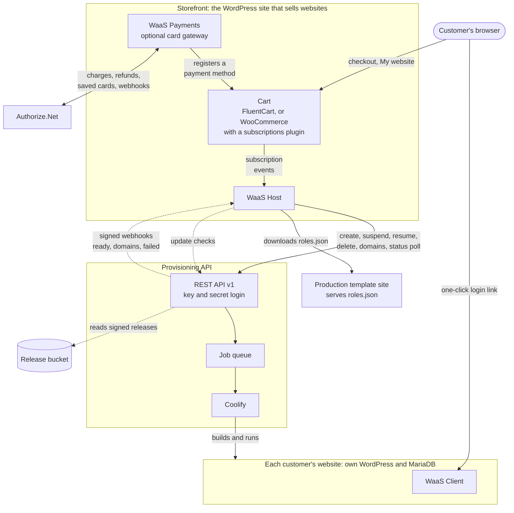
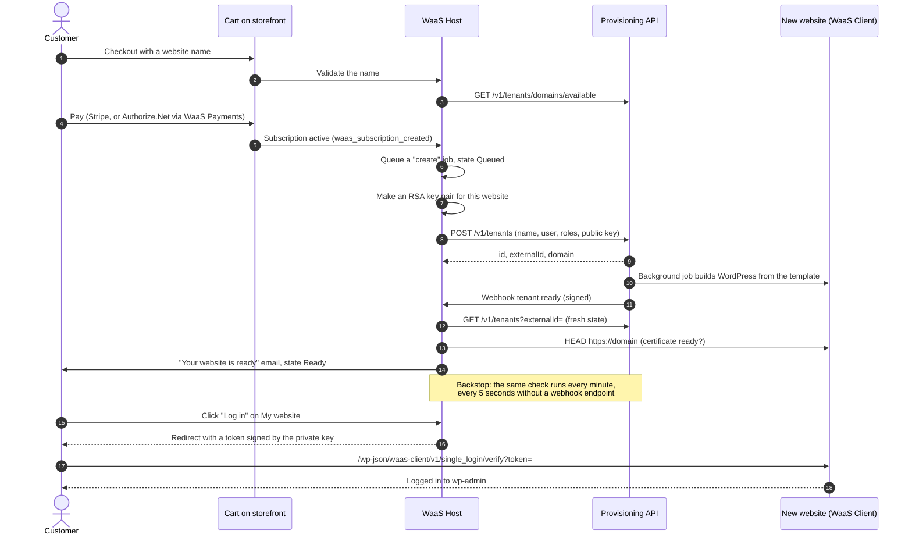
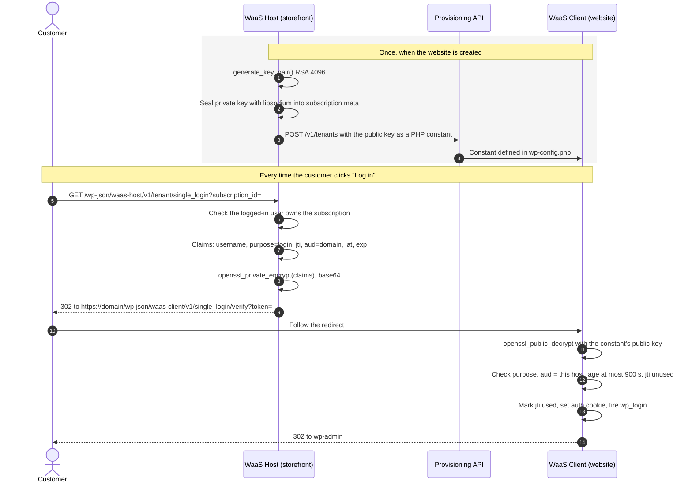
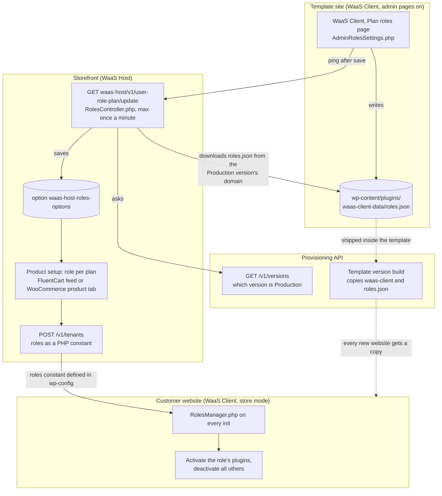
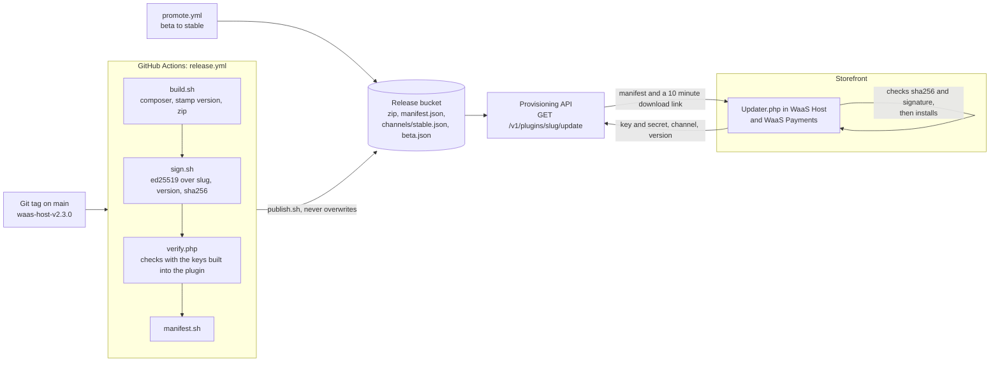

# How the plugins work

These pages explain how **WaaS Host**, **WaaS Client** and **WaaS Payments** work, and how they fit together with the provisioning API. Each diagram is drawn from the code and names the files it comes from, so you can check it and keep it current.

| Page | What it covers |
|---|---|
| This page | Where each plugin runs, a website's life from purchase to login, plan roles, updates |
| [WaaS Host](waas-host.md) | Cart adapters, the background job queue, store states, every API call, the API's webhooks, the account API |
| [WaaS Client](waas-client.md) | What runs on the template and in each store, plan-based plugins, one-click login checks |
| [WaaS Payments](waas-payments.md) | Authorize.Net checkout, saved cards, renewals, webhooks, refunds |

Paths are relative to `packages/` unless they start with `docs/` or `scripts/`.

## Where each plugin runs

| Plugin | Runs on | Its job | Entry file |
|---|---|---|---|
| WaaS Host | The storefront | Turns subscription events into API calls, tracks each website's state, gives customers one-click login | `waas-host/index.php` |
| WaaS Client | The template and every customer website | Checks one-click login tokens, turns plugins on or off by plan role | `waas-client/index.php` |
| WaaS Payments | The storefront, only when card payments go through Authorize.Net | A FluentCart payment method with saved cards and renewals | `waas-payments/waas-payments.php` |
| waas-updater | Copied into Host and Payments | Checks for, downloads and verifies signed updates | `waas-updater/src/Updater.php` |

Three things worth knowing up front:

- **WaaS Host is the only plugin that calls the provisioning API** (`waas-host/src/Core/ProvisioningApi.php`). WaaS Client never calls it, and WaaS Payments only talks to Authorize.Net.
- **The API calls only WaaS Host, and only with signed webhooks.** WaaS Host registers its own endpoint and the API tells it when a website is ready, restored, has new domains or failed. A poll every minute stays on as a backstop, every five seconds if the endpoint couldn't be registered (`waas-host/src/Features/Webhooks.php`, `waas-host/src/Api/WebhookReceiver.php`, `waas-host/src/Features/TenantStatusService.php`). See [WaaS Host, webhooks](waas-host.md#webhooks).
- **WaaS Client is not installed by the API.** It ships inside the template, so every website made from that template already has it, active.

## A website's life, end to end

One purchase, from checkout to the customer logged in to their new website. Each plugin's page breaks its own part down further.

Sources: `waas-host/src/Commerce/FluentCart/FluentCartCheckout.php`, `waas-host/src/Features/UserWcTenantsCheckout.php`, `waas-host/src/Features/TenantsSubscriptionManager.php` (`create_tenant_when_subscription_created`, `job_create`), `waas-host/src/Api/WebhookReceiver.php`, `waas-host/src/Features/TenantStatusService.php`, `waas-host/src/Features/Notifications.php`, `waas-host/src/Api/SingleLogin.php`, `waas-client/src/Api/SingleSignOnController.php`.

## One-click login

The storefront and the website share no password and no session. At creation WaaS Host makes an RSA key pair for the website, keeps the private half, and sends the public half to the API as a PHP constant. The API writes it into the website's `wp-config.php`. A login token is a small JSON claim set encrypted with the private key, which only the matching public key can open.

- The private key is sealed with a key derived from `WAAS_HOST_KEY_ENCRYPTION_KEY` (or the WordPress auth salt) by `waas-host/src/Core/PrivateKeyStore.php`.
- Tokens from the storefront live 300 seconds (`waas-host/src/Api/SingleLogin.php`). The website accepts at most 900 seconds with 60 seconds of clock skew, and each `jti` only once (`waas-client/src/Api/SingleSignOnController.php`).
- Every failure gets the same 403, so a bad token reveals nothing about why.
- The API takes no part at login time. A suspended website cannot be logged in to, because the API's guard answers every request with the unavailable page.
- Front ends on other domains (for example a headless account page) get the same link from `POST /wp-json/waas-host/v1/account/websites/{id}/login` instead of a redirect ([WaaS Host, account API](waas-host.md#customer-account-api)).

## Plan roles: which plugins a website gets

A **plan role** is a name such as `basic` or `pro` that maps to a list of plugins. The list lives in one file, `roles.json`, on the template. The storefront only needs the role names (to pick one per product), and each website needs the plugin lists (to turn plugins on and off).

- The ping from the template is only a trigger. The storefront always downloads `roles.json` from the version marked **Production** in the API, whichever site sent the ping (`waas-host/src/Api/RolesController.php`).
- On a website, roles come from the roles constant and plugin lists from the local `roles.json`. If no role matches, nothing changes and the admin sees a notice (`waas-client/src/Features/RolesManager.php`).
- Adding or removing an add-on on WooCommerce changes the roles: WaaS Host sends `PUT /v1/tenants` with the new roles constant, and the API restarts the website with it (`waas-host/src/Features/TenantsAddOnSubscriptionManager.php`).

## Updates and releases

WaaS Host and WaaS Payments update themselves through the provisioning API. WaaS Client does not: a website gets a newer WaaS Client when it moves to a newer template version.

- Payments borrows WaaS Host's API login through the `waas_update_credentials` filter (`waas-host/src/Updater/Module.php`), so it only updates where WaaS Host is installed.
- `WAAS_UPDATE_CHANNEL` picks `stable` (default) or `beta`. `WAAS_AUTO_UPDATE` set to `patch` installs patch releases automatically.
- A download that fails either check is deleted before WordPress touches the installed plugin (`waas-updater/src/Updater.php`).
- The library is copied into each plugin by `scripts/sync-updater.sh`. CI fails if a copy drifts. More detail: [releases.md](../releases.md).
