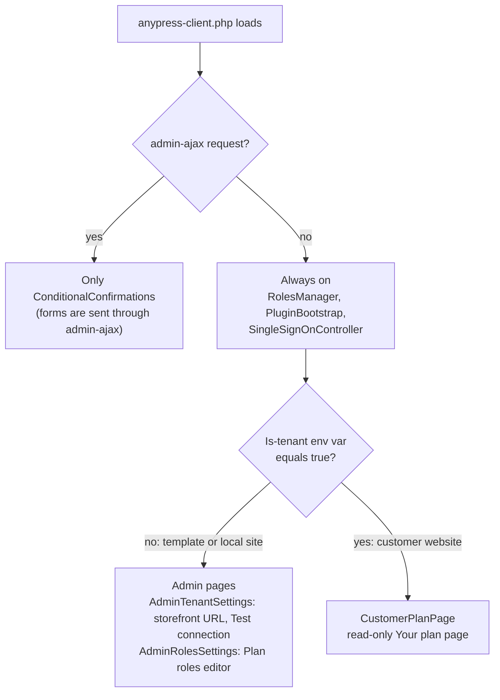
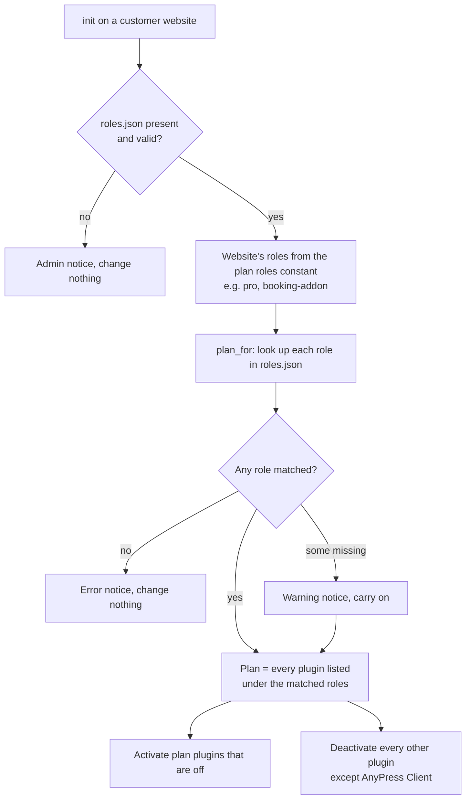
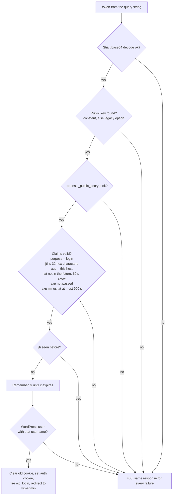
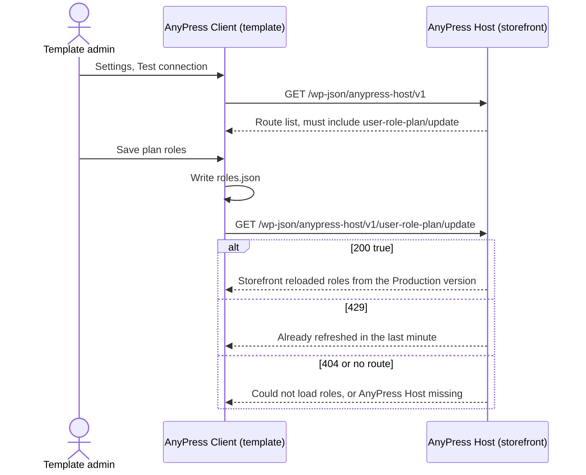

# AnyPress Client

AnyPress Client lives inside the template that customer websites are copied from, so it is in every website. Paths are relative to `packages/anypress-client/`.

What it does:

| Job | Where it runs | Section |
|---|---|---|
| Checks one-click login links from the storefront and the dashboard | Every website | [Checking a Login Token](#checking-a-login-token), [Log In to WordPress From the Dashboard](#log-in-to-wordpress-from-the-dashboard) |
| Turns plugins on or off for the website's plan | Every website | [Plugins by Plan Role](#plugins-by-plan-role) |
| Lets you edit the plan roles | The template only | [Two Modes](#two-modes-template-and-customer-website) |
| Gives the AnyPress API, AI apps and WordPress's own AI tools a safe way to edit pages and design | Every website | [Site Tools, Abilities and MCP](#site-tools-abilities-and-mcp) |
| Answers the phone receptionist: open times, bookings and callers | Every website | [Phone Receptionist Routes](#phone-receptionist-routes) |
| Shows the website assistant beside the editor | Every website | [The Website Assistant Beside the Page](#the-website-assistant-beside-the-page) |
| Moves forms, a WooCommerce shop, a CRM list, a help desk, affiliates, a community (also from Circle) or LearnDash courses onto the Fluent plugins | Moved-in websites | [Moving Forms](#moving-forms-to-fluent-forms) and the sections after it |

AnyPress Client calls the AnyPress API in one place only: the assistant's sign-in. Everything else the API asks of a website comes in as a request signed with that website's own site key.

[Back to the overview](README.md)

## Its Name on a Reseller's Websites

On a reseller's websites the plugin goes by the reseller's brand instead of AnyPress: the plugins list shows "<brand> Client" with the reseller as author, and its menu, notices and the website's MCP server use the same name. The AnyPress API keeps the brand in the `anypress_brand_name` option, set when a website is built, restored or rolled back, and on every running website when the reseller's brand changes. Without the option the name is AnyPress Client. The plugin's folder, text domain and update address stay the same either way. Source: `src/Core/Brand.php`.

## Two Modes: Template and Customer Website

The same plugin behaves differently depending on one environment variable, the "is tenant" flag, which the AnyPress API sets to `true` on every customer website and nowhere else.



Sources: `anypress-client.php`, `src/Features/PluginBootstrap.php`, `src/Features/AdminTenantSettings.php`, `src/Features/AdminRolesSettings.php`, `src/Features/CustomerPlanPage.php`.

### What a Customer Website Is Given

AnyPress Client reads everything it needs from the website itself. AnyPress Host puts the constants in its `POST /v1/tenants` request, and the API writes them into `wp-config.php`.

| Setting | Kind | Comes from | Read by |
|---|---|---|---|
| Is-tenant flag (`true`) | Environment variable | The API's website container | `anypress-client.php`, `RolesManager.php`, `PluginBootstrap.php` |
| Plan roles (comma list) | PHP constant | AnyPress Host, from the products bought | `RolesManager.php` |
| Login public key (base64 PEM) | PHP constant | AnyPress Host, one key pair per website | `SingleSignOnController.php` |
| Remove plugin rights from administrators (`true`/`false`) | PHP constant | AnyPress Host setting | `PluginBootstrap.php` |
| `anypress_host_website_url` | WordPress option | Set on the template, copied into each website | `CustomerPlanPage.php` |
| `anypress-client-data/roles.json` | File | Shipped inside the template | `RolesManager.php`, `CustomerPlanPage.php` |

## Plugins by Plan Role

On a customer website, on every `init`, `RolesManager` makes the active plugins match the website's plan.



Source: `src/Features/RolesManager.php` (`activate_enabled_plugins`, `plan_for`).

- `roles.json` looks like `{"pro": {"title": "Pro", "plugins": ["fluent-crm/fluent-crm.php", ...]}}` (`src/Features/AdminRolesSettings.php`).
- When the remove-plugin-rights constant is `true`, the website's administrators lose the six plugin capabilities (activate, delete, install, update, edit, upload). The Plugins screen shows "Activated by AnyPress Client" in place of the toggle links (`src/Features/PluginBootstrap.php`).
- The **Your plan** page lists each role and its plugins, and links back to the storefront. It makes no network calls.

How roles get from the template to the storefront is drawn in the overview: [Plan roles](README.md#plan-roles-which-plugins-a-website-gets).

## Checking a Login Token

`GET /wp-json/anypress-client/v1/single_login/verify?token=...` is public, because the signed token is the credential. Every check must pass, and every failure gets the same 403 `anypress_single_login_failed`.



Sources: `src/Api/SingleSignOnController.php` (`verify_single_login`, `claims_are_valid`), `src/Core/DecryptionService.php`.

- The username is the one AnyPress Host created the website with, built from the customer's name (`anypress-host/src/Features/SingleLoginService.php`).
- The `anypress_sso_admin_url` filter can send the user somewhere other than wp-admin.

## Log In to WordPress From the Dashboard

The dashboard's **Log in to WordPress** button works without the storefront. The AnyPress API signs a link to `GET /wp-json/anypress-client/v1/admin-login` with the website's site key. Opening it signs the browser in as the website's first administrator and goes to wp-admin. The link works once and only for a few minutes, and its signature covers a method no real request uses, so a signed site request can never be turned into a login. Source: `src/Api/AdminLogin.php`, checked by `src/Core/SignedRequest.php`.

## Site Tools, Abilities and MCP

Three ways in share one set of site tools, which change pages, sections, styles, the header, the footer, menus and images, and keep a revision of each change:

| Way in | Who uses it | How it signs in |
|---|---|---|
| The site-editing REST routes (`/wp-json/anypress-client/v1/site/...`) | The AnyPress API, for the AnyPress connector, the website assistant and the automation apps | A request signed with the website's site key (`ANYPRESS_SITE_KEY`), checked by `src/Core/SignedRequest.php` |
| WordPress abilities (`anypress/...`) | AI tools inside WordPress | The signed-in WordPress user's own capabilities |
| The website's own MCP server (`/wp-json/mcp/anypress`) | AI apps the owner trusts | An application password for a WordPress user who can edit pages. The owner turns it on or off on the **Your plan** page. |

Before an app reaches a website through the AnyPress API, the owner approves it on the website's **Sign in with your website** page (`wp-admin/admin.php?page=anypress-connect`, administrators only). Routes, safety rules and the ability list: [Site Editing API](../site-editing-api.md). Sources: `src/Api/SiteController.php`, `src/Api/SiteAbilities.php`, `src/Features/McpServer.php`, `src/Features/ConnectPage.php`, `src/Core/ConnectLink.php`.

## Phone Receptionist Routes

The phone receptionist asks the website, through the AnyPress API, for what it needs during a call. Only the AnyPress API can call these routes, signed with the site key like the site tools, and they run as the first administrator.

| Route | What it does |
|---|---|
| `GET /wp-json/anypress-client/v1/site/phone/services` | The FluentBooking booking types the receptionist can offer |
| `GET .../site/phone/services/{id}/times` | The open times for one booking type |
| `POST .../site/phone/bookings` | Books a time through FluentBooking's own slot lock, so a phone booking can't take a time a web visitor just booked |
| `POST .../site/phone/callers` | Saves the caller in FluentCRM with a note. A caller who gives no email is kept under `caller-<digits>@phone.invalid`, the same for every call from that number. |

Source: `src/Api/PhoneController.php`. Tested by `scripts/playground/phone.mjs` (`npm run phone`).

## Talking to the Storefront

AnyPress Client only calls the storefront, and only from the template's admin pages.



Sources: `src/Features/StorefrontStatus.php`, `src/Core/HttpService.php`, `anypress-host/src/Api/RolesController.php`.

## Moving Forms to Fluent Forms

A website moved into AnyPress often has its forms in Contact Form 7, WPForms (Lite) or Ninja Forms. The forms switch moves them to Fluent Forms and switches the pages over. Run it with WP-CLI as an administrator, with Fluent Forms and the old form plugins active:

```sh
wp anypress forms switch --user=admin --dry-run   # what would be converted, dropped and switched; changes nothing
wp anypress forms switch --user=admin             # do it
wp anypress forms switch --user=admin --undo      # put the old shortcodes and blocks back
```

Add `--format=json` for the report as JSON. The same is available as two abilities: `anypress/check-forms` (the dry run, read-only) and `anypress/switch-forms` (with `{"undo": true}` to undo). Both need an administrator.

What it does, in order:

1. **Converts each form** with Fluent Forms' own importer (Fluent Forms → Tools → Migrator), and fixes what that importer gets wrong:
   - Contact Form 7: the emails are built from the form's Mail and Mail (2) (recipient, sender, subject, body, Reply-To, Cc, Bcc, with the mail tags turned into Fluent Forms smart codes), the thank-you message from its "sent" message, and the malformed notification rows the importer writes are deleted. Placeholders stay placeholders and a date field stays a date.
   - WPForms: the confirmation that applies to every submission is the main one, and a conditional one (such as a redirect for one answer) stays conditional. Free Fluent Forms stores conditional confirmations but only Fluent Forms Pro runs them, so AnyPress Client runs them for the converted forms while Pro is off (`src/Forms/ConditionalConfirmations.php`).
   - Ninja Forms: each email keeps its own Reply-To, and the date format is converted (`MM/DD/YYYY` becomes `m/d/Y`).
   - Entries (Contact Form 7 through Flamingo, Ninja Forms, WPForms Pro) keep the date each was sent and their order; Contact Form 7 entries also keep the visitor's IP address and page. All Flamingo messages are read, not only the first 10.
2. **Reports** every dropped field of each form by name and type, with the reason (most need Fluent Forms Pro), and anything else that didn't come across: show/hide rules on fields, email attachments, mail tags with no Fluent Forms equivalent, entries past Fluent Forms' limit of 1,000 per form.
3. **Switches the pages over**: the old shortcodes (`[contact-form-7]`, `[contact-form]`, `[wpforms]`, `[ninja_form]`, `[ninja_forms]`) and blocks become `[fluentform id="…"]` and the Fluent Forms block, in posts, pages, templates, template parts, synced patterns and Text, Custom HTML and block widgets. Each changed post keeps a revision. Forms inside a page builder's own layout (Elementor, Beaver Builder) are listed in the report, not changed.

Running it again changes nothing that was already done: converted forms are skipped, entries are only brought into a Fluent Forms form that has none, and pages already switched have nothing left to swap. The old plugins and their forms are never changed, deactivated or deleted, so they keep working until the owner turns them off. Undo puts back the exact old content of each page or widget that wasn't edited since, and swaps the forms back in one that was; the Fluent Forms forms and their entries stay.

The id map and each changed page's original content are kept in the `anypress_client_forms_switch` option (not autoloaded). Sources: `src/Forms/FormsSwitch.php`, `src/Forms/Migrators/`, `src/Forms/PageSwitcher.php`, `src/Forms/FormsCommand.php`, `src/Forms/FormsAbilities.php`. Tested end to end by `scripts/playground/forms.mjs` (`npm run forms`).

## Moving a WooCommerce Shop to FluentCart

The shop switch copies a WooCommerce shop into FluentCart with the free FluentCart Migrator add-on, then adds what the add-on leaves out. The add-on is not on wordpress.org: it is on FluentCart's add-ons page (https://fluentcart.com/fluentcart-addons, zip at https://addons-cdn.fluentcart.com/fluent-cart-migrator.zip). Run it with WP-CLI as an administrator, with WooCommerce, FluentCart and the add-on active:

```sh
wp anypress shop switch --user=admin --dry-run   # check the shop and report what the switch would do; changes nothing
wp anypress shop switch --user=admin             # do it
wp anypress shop switch --user=admin --undo      # take the switch's own fixes back out
```

Add `--format=json` for the report as JSON. The same is available as two abilities: `anypress/check-shop` (the dry run, read-only) and `anypress/switch-shop` (with `{"undo": true}` to undo). Both need an administrator.

What it does, in order:

1. **Checks** that WooCommerce, FluentCart and the add-on are active (and says where to get the add-on when it's missing), and reports where WooCommerce keeps its orders (HPOS on or off), the counts (products, variations, orders by status, guest orders, refunds, coupons, registered customers, tax rates, shipping zones, product tags) and whether WooCommerce Subscriptions is in use.
2. **Runs the add-on's WooCommerce migration** through its own PHP classes, the same steps as its `wp fluent_cart_migrator migrate_from_woo --all`: products and store settings, tax rates, coupons, orders (with their refunds, payments and addresses), registered customers without orders, and the stats recount. The add-on reads WooCommerce through its own API, so HPOS on or off gives the same result. Records it couldn't copy are listed from its own log.
3. **Fills the add-on's gaps**:
   - Gallery images: each FluentCart product gets its WooCommerce gallery images after the featured image (the add-on copies only the featured image).
   - Shipping: each WooCommerce shipping zone, and the "rest of the world" zone, becomes a FluentCart zone, with its flat rate, free shipping and local pickup methods. A zone on one country, several countries, a continent or the states of one country maps across; postcodes, states mixed with other countries, shipping class costs and cost formulas FluentCart can't hold are reported. A free shipping method that needs a minimum order or a coupon is copied turned off, since FluentCart's free shipping has no conditions.
   - Customers: the add-on finds customers by billing email, so a registered customer who ordered with another billing email becomes two FluentCart customers with the same WordPress user. They are merged into the one with the account's email: orders, subscriptions, download permissions, carts, addresses, customer meta, reviews, labels and activity move across, FluentCart's `fluent_cart/customer_resources_moved` action runs (FluentCart Pro moves its licences on it), and the stats are recounted.
4. **Lists what to check by hand**, without changing anything: products with tags (FluentCart has no product tags), and each WooCommerce tax rate whose value, name, shipping flag, compound flag, postcodes, cities or tax class differ from the FluentCart rate the add-on mapped it to (the add-on uses FluentCart's built-in rates, not WooCommerce's).
5. **Compares WooCommerce with FluentCart** and lists every difference: products, SKUs, orders (each order's total and refunds), the sum of order totals, refunds, coupons and customers (including any WordPress user who still has more than one FluentCart customer).

Running it again adds nothing twice: the add-on skips each step it has finished, gallery images already there are kept, each zone and method is copied once, and merged customers have nothing left to merge. WooCommerce and its data are never changed, deactivated or deleted. Undo puts back the galleries as the add-on left them, removes the copied shipping zones and methods, and splits the merged customers again; what the add-on copied stays, because the add-on has no undo outside its developer mode.

The galleries before the switch, the copied zone and method ids and each merged customer (its row and the rows moved off it) are kept in the `anypress_client_shop_switch` option (not autoloaded). Sources: `src/Shop/ShopSwitch.php`, `src/Shop/GalleryImages.php`, `src/Shop/ShippingZones.php`, `src/Shop/CustomerMerge.php`, `src/Shop/ShopReview.php`, `src/Shop/ShopCompare.php`, `src/Shop/ShopCommand.php`, `src/Shop/ShopAbilities.php`. Tested end to end, with HPOS off and on, by `scripts/playground/shop-switch.mjs` (`npm run shop-switch`).

## Bringing Buyers and Subscribers Into FluentCRM

The CRM switch brings a website's WooCommerce buyers and email-list subscribers into FluentCRM (the free plugin, whose own importers cover only WordPress users, CSV files and a few hosted services; its WooCommerce importer needs FluentCRM Pro). Run it with WP-CLI as an administrator, with FluentCRM active:

```sh
wp anypress crm switch --user=admin --dry-run   # report what would come in, and with which status; changes nothing
wp anypress crm switch --user=admin             # do it
wp anypress crm switch --user=admin --undo      # take it back out
```

Add `--format=json` for the report as JSON, and `--without-consent=unsubscribed` to give buyers with no consent record the status unsubscribed instead of transactional. The same is available as two abilities: `anypress/check-crm` (the dry run, read-only) and `anypress/switch-crm` (with `{"undo": true}` to undo). Both take `without_consent` and need an administrator.

Sources, in this order (the first source with a name, phone or address gives it):

1. **WooCommerce buyers, guests included**, read from the orders through WooCommerce's own order API, so HPOS on or off reads the same. Only paid orders (processing, completed and any other paid status) and fully refunded ones count; pending, failed and cancelled orders don't make anyone a buyer. A registered customer comes in under their account email, a guest under their billing email. They get their name, phone and billing address from their latest order, the type "customer", two number fields (`woocommerce_orders`, the paid orders that weren't fully refunded, and `woocommerce_spent`, the total less refunds), and a tag per product bought, `Product: Past` (the Offering: Interested/Active/Past tagging model: past buyers get Past only, a full refund gives no tag, and a `Product: Interested` tag on the contact is removed).
2. **MailPoet subscribers**, read from its tables. Subscribed stays subscribed, unconfirmed becomes pending, unsubscribed and bounced stay that way, inactive becomes unsubscribed, and trashed subscribers are left out. MailPoet's own lists become FluentCRM lists of the same name, with the people who are on them; its automatic lists and segments (WordPress Users, WooCommerce Customers) are reported, not copied.
3. **Newsletter plugin subscribers**, read from its table: confirmed becomes subscribed, not confirmed pending, and unsubscribed, bounced and complained stay that way; unfinished sign-ups are left out. Its named lists become FluentCRM lists.

Other email-list plugins (Mailster, Icegram Express, Noptin and others) are named in the report: export their subscribers to CSV and bring them in with FluentCRM's CSV import.

**Consent.** A contact is subscribed only where a source holds a consent record that says so: a MailPoet or Newsletter subscription, or a Mailchimp for WooCommerce opt-in (on the order or the account). An unsubscribe, bounce or complaint in any source wins over a subscription in another. A buyer with no consent record gets "transactional": FluentCRM sends them order and account emails but no campaigns. A contact already in FluentCRM keeps its own data: only empty fields are filled, a subscription only lifts a pending or transactional contact, a suppression is never lifted, and with no consent record its status is left alone.

**No email.** FluentCRM's tag and list events are off while it writes (as in FluentCRM's own command-line import), so no automation starts, and any email something tries to send during the run is held back and counted in the report. No double opt-in email is sent to pending contacts.

Running it again changes nothing already there. MailPoet, Newsletter and WooCommerce and their data are never changed. Undo deletes the contacts, tags, lists and custom fields the switch created, and puts back what it changed on contacts that were already in FluentCRM (their fields, status, custom values, and the tags and lists it added or removed).

What doesn't come across: order lines and history (FluentCRM free keeps none), campaigns, automations, statistics and engagement scores, MailPoet's custom subscriber fields, and the Newsletter plugin's profile fields.

What the switch created, and each existing contact's values before it changed them, are kept in the `anypress_client_crm_switch` option (not autoloaded). Sources: `src/Crm/CrmSwitch.php`, `src/Crm/ContactPlan.php`, `src/Crm/WooBuyers.php`, `src/Crm/MailPoetSubscribers.php`, `src/Crm/NewsletterSubscribers.php`, `src/Crm/CrmWriter.php`, `src/Crm/CrmCommand.php`, `src/Crm/CrmAbilities.php`. Tested end to end, with HPOS off and on, by `scripts/playground/crm-switch.mjs` (`npm run crm-switch`).

## Moving a Help Desk, an Affiliate Program or a Community

Fluent Support, FluentAffiliate and FluentCommunity each have their own importer. Three switches run those importers and add what they leave to the person running them: a check first, a count of what the source holds next to what came across, no email while they run, one run at a time, and an undo. Run them with WP-CLI as an administrator, with the Fluent plugin active:

```sh
wp anypress support switch --user=admin --dry-run     # check and count; changes nothing
wp anypress affiliate switch --user=admin             # do it
wp anypress community switch --user=admin --undo      # take it back out
```

Add `--from=<source>` when more than one source plugin is active, and `--format=json` for the report as JSON. Each is also two abilities: `anypress/check-support`, `anypress/check-affiliate` and `anypress/check-community` (the dry run, read-only), and `anypress/switch-support`, `anypress/switch-affiliate` and `anypress/switch-community` (with `{"undo": true}` to undo). They take `from` and need an administrator.

| Switch | Sources (`--from`) | What comes across | Runs into |
|---|---|---|---|
| support | Awesome Support (`awesome-support`), SupportCandy (`support-candy`), JS Help Desk (`js-helpdesk`) | Tickets with their replies, attachments, customers and agents | Any Fluent Support: it skips tickets it already imported. If it has no business inbox yet, the switch makes one in the website's name, as Fluent Support's setup screen does. |
| affiliate | AffiliateWP (`affiliate_wp`), Affiliates Manager (`affiliate_manager`), Solid Affiliate (`solid_affiliate`), SliceWP (`slicewp`), Ultimate Affiliate Pro (`ultimate_affiliate`) | Affiliate groups, affiliates, referrals, customers, payouts and visits, with earnings recounted | An empty FluentAffiliate only: its importer keeps the source ids. |
| community | BuddyPress or BuddyBoss (`buddypress`) | Groups become spaces with their members and roles; activity posts become posts with their comments, reactions and media; member profiles are synced | An empty FluentCommunity only (no spaces or posts): its command-line importer wipes FluentCommunity first, so the switch uses the one behind its Migrations screen. |

FluentCommunity's importer makes every BuddyPress group membership an active member, so after it runs the switch takes banned members out of their spaces again and makes membership requests and invitations that weren't accepted pending, for a space admin to approve.

The source plugin and its data are never changed: none of the importers' "delete the source" steps is called. Running a switch again is refused until it is undone. Undo deletes what the switch added (tickets, replies, attachments, the inbox it made and the people only those tickets name; the FluentAffiliate rows; the FluentCommunity spaces, members, posts, comments, reactions, media and new profiles) and the marks the importers leave so they can skip what they already brought across.

What doesn't come across: ticket tags, products and custom fields, and the help desk's settings, templates and canned replies; affiliate program settings, and creatives (FluentAffiliate Pro); private messages, friendships, forums and extended profile fields. Help Scout, Zendesk and Freshdesk need an API key and come in through Fluent Support's own import screen. bbPress, PeepSo, wpForo and Ultimate Member, and WP Support Plus, KB Support, YITH WooCommerce Affiliates, Affiliate for WooCommerce and Easy Affiliate, are named in the check when active: the Fluent plugins have no importer for them.

What each switch added is kept in the `anypress_client_<switch>_import` option (not autoloaded). Sources: `src/Moving/NativeImport.php`, `src/Moving/SupportImport.php`, `src/Moving/AffiliateImport.php`, `src/Moving/CommunityImport.php`, `src/Moving/ImportCommand.php`, `src/Moving/ImportAbilities.php`. Tested end to end with Awesome Support, SliceWP and BuddyPress by `scripts/playground/moving.mjs` (`npm run moving`).

## Moving LearnDash Courses

FluentCommunity has no LearnDash importer of its own yet, so the course switch builds the courses through FluentCommunity's own course admin routes (the ones behind its course editor). It works like the switches above: a check first, a count of what LearnDash holds next to what came across, no email while it runs, one run at a time, and an undo.

```sh
wp anypress course switch --user=admin --dry-run     # check and count; changes nothing
wp anypress course switch --user=admin               # do it
wp anypress course switch --user=admin --undo        # take it back out
```

The abilities are `anypress/check-course` and `anypress/switch-course` (with `{"undo": true}` to undo); both need an administrator.

LearnDash doesn't need to be active. A store of the community site type turns it off, and LearnDash keeps everything the switch needs in WordPress itself: its courses, lessons, topics and quizzes are posts, the course builder's order and section headings are course settings, and enrolments and progress are user meta. The switch reads those.

| LearnDash | FluentCommunity |
|---|---|
| A course | A self-paced course with the same title. Its excerpt (or the start of its text) is the description and its text the course details. Open courses are public, every other price type private. Published stays published; anything else is a draft. |
| Section headings | Sections, holding the lessons (and their topics) that follow each heading. |
| Lessons with topics (no headings) | Each lesson becomes a section: the lesson's own text, if it has any, is its first lesson, and its topics the lessons after it. |
| Lessons without topics (no headings) | One section, "Lessons", holding them all. |
| A lesson or topic | A lesson with the same title, text, featured image and status, comments on. A lesson video becomes an embed at the top. |
| Students | Everyone enrolled one by one, through a LearnDash group, or on the course's access list; for an open course, everyone who started it. They are enrolled the way FluentCommunity enrols them. |
| Progress | The lessons and topics each student finished and the courses they completed, recorded as FluentCommunity records them, without its "lesson completed" events, so old progress starts no automation. |

Courses already in FluentCommunity are left alone. What doesn't come across: quizzes, assignments and certificates; prices and how access is sold (sell the courses with FluentCart); drip schedules and prerequisites; LearnDash groups as such (their members become students); LearnDash shortcodes and blocks inside lessons, which show as text. An automation set to start when someone joins a course starts for each student the switch enrols, so the check says to pause those first.

Undo deletes the courses the switch made, with their sections, lessons, students and progress (through FluentCommunity's own course delete), and the member profiles FluentCommunity made for those students. Sources: `src/Moving/CourseImport.php` (on `NativeImport`). Tested end to end on a store of the community site type, with the FluentCommunity the store template installs and the newest one, by `scripts/playground/courses.mjs` (`npm run courses`).

## Moving a Circle Community

Circle is a hosted service, not a WordPress plugin, and has no export file, so the Circle switch reads the community through Circle's Admin API v2 with the community's own Admin V2 token (Circle: Settings, Developers, Tokens; Circle's Business plan and higher have the Admin API). The token is used for that run only: it isn't saved, logged or shown. Circle is only read. Circle publishes no PHP library for its Admin API, so `src/Moving/CircleApi.php` calls it with the WordPress HTTP API, 100 records a page, waiting and trying again when Circle says to slow down. Like the switches above, it checks first, counts what Circle holds next to what came across, sends no email while it runs, runs once, and has an undo. It only brings a community into an empty FluentCommunity.

```sh
CIRCLE_API_TOKEN=... wp anypress circle switch --user=admin --dry-run   # check and count; changes nothing
CIRCLE_API_TOKEN=... wp anypress circle switch --user=admin             # do it (or --token=...)
wp anypress circle switch --user=admin --undo                           # take it back out
```

The abilities are `anypress/check-circle` and `anypress/switch-circle`, each with a `token` input (and `{"undo": true}` to undo); both need an administrator.

Every call counts against the Circle plan's monthly Admin API allowance (5,000 on Business, 30,000 on Scale), so the check says about how many calls the switch will make. For a big community, run it with WP-CLI so a web request doesn't time out half way. Course students are enrolled the way FluentCommunity enrols them, so an automation set to start when someone joins a course starts for each of them; the check says to pause those first.

| Circle | FluentCommunity |
|---|---|
| A space group | A space group with the same name, in the same order. |
| A discussion space | A space in its group. A public space is public; a private one is private, or secret when it is hidden from non-members. When members can't post, only admins and moderators can. |
| An active member | A WordPress subscriber with a community profile (their Circle headline as the bio), or the user the site already has with that email. No email is sent; members set a password with "Lost your password?". |
| A space member or moderator | A member or moderator of the space. |
| A topic | A topic, offered in the spaces Circle offers it in. |
| A post | A post with the same title, text (Circle's HTML, made safe), author, date and topics. A post by someone who has left Circle is shown as the admin's. |
| A comment or reply | A comment, by the same person on the same date. FluentCommunity shows one level of replies, so a reply to a reply goes under the comment it belongs to. |
| A course space (2.24.0) | A self-paced course with the same name and privacy, made through FluentCommunity's own course admin routes as the LearnDash switch makes them. Its sections and lessons come in Circle's order, each lesson with its text (made safe), draft or published. Its members are enrolled as students, after the lessons, so publishing a lesson notifies nobody. |

What doesn't come across: who liked what (Circle's API gives only the number of likes); chat, event, image and members spaces; course progress (Circle's API can't read which lessons a student finished, so students start each course from the beginning), lesson videos and files uploaded to Circle, lesson order rules and drip schedules; direct messages; passwords; profile photos, custom profile fields, member tags, paywalls and access groups. Images and files in posts stay on Circle's servers.

Undo deletes what the switch made: the courses (through FluentCommunity's own course delete, with their sections, lessons and students), the users it made (users already on the site stay, and only lose the Circle mark), spaces, space groups, topics, posts, comments and the community profiles made for the members. Sources: `src/Moving/CircleImport.php` (on `NativeImport`), `src/Moving/CircleApi.php`, `src/Moving/CirclePeople.php`. Tested end to end on a store of the community site type, with the FluentCommunity the store template installs and the newest one, against a fake Circle Admin API with Circle's own response shapes, by `scripts/playground/circle.mjs` (`npm run circle`).

## The Website Assistant Beside the Page

Since 2.8.0 a store's administrators (anyone who can change its design, `edit_theme_options`) get an **Assistant** panel in the block editor and the Site Editor, opened from its star button in the editor's top bar, and an **Assistant** button in the admin bar that opens the page being viewed (or the Site Editor) with the panel open. The panel frames the website assistant's chat. Since 2.12.0 it is on the website's own domain, `https://<its domain>/.assistant/editor`, which the server's proxy sends to the assistant, so the owner never leaves their website and nothing names the platform (before, `https://assistant.anypress.io/editor`). `ANYPRESS_ASSISTANT_URL` changes it. The dot keeps it from hiding a page: WordPress never gives a page an address starting with one.

- **Sign-in.** The chat asks the editor to sign it in. AnyPress Client's `POST /wp-json/anypress-client/v1/assistant/handoff` (same capability) asks the AnyPress API (`ANYPRESS_API_URL`, default `https://api.anypress.io`) at `POST /oauth/site/store-handoff`, signed with the store's site key, and frames the one-time sign-in it answers. Only an address on the assistant's own site is framed.
- **What the chat sees.** With each message the editor sends what it has open: the post type and id, its title, its top-level blocks and the selected block, each with its block markup.
- **Changes.** The assistant's editor changes come back as replace, insert, remove or replace-everything, and land in the editor like any edit. The changed block scrolls into view with a brief outline. Since 2.11.0 one quiet line under the panel's header says what changed ("Heading changed", or "3 changes"), "Not saved", **Undo** (**Undo all** for several changes since the last save) and **Save**; it goes once nothing is unsaved and says "Saved" for a moment after a save. Nothing is saved until the owner saves, from that line or the editor's own Save button.
- **Getting around (2.11.0).** Ctrl + . (⌘ + . on a Mac) opens and closes the panel, from the editor, the page or the chat. On a phone, where WordPress hides the admin bar and top-bar buttons, a round Assistant button floats at the bottom right while the panel is closed. Opening the editor from the Assistant button switches off WordPress's one-time welcome guides for that person, so they don't cover the panel. The chat can ask for a wider panel (560px, on screens 1080px and wider) and can clear the selected block.
- **What the assistant knows about the business (2.11.0).** The signed site route `GET /site/business` answers what the site already says (name, tagline, language, time zone, the plan's site type, the purchase's business details: name, phone, city, state and country, the shop's currency, and its products and prices, booking types and forms by name) and what the owner has told the assistant (`about`: what the business does, who it is for, where, opening hours, how customers reach it, how it should sound, anything else), kept in the `anypress_business_profile` option. `PATCH /site/business` saves only the fields given (an empty one clears it), `POST /site/business/undo` puts back the version before. Until the owner saves their own, the checkout's optional business answer (`anypress_store_owner.about`) is what the business does. `src/Core/BusinessProfile.php`.
- Messages go only to and from the assistant's own address (`postMessage` with its origin).
- Stores only: without a site key (`ANYPRESS_SITE_KEY`) there is no panel and no button.

## Updates

AnyPress Client does not update itself. Its `Update URI` header only keeps wordpress.org from offering updates. A website gets a newer AnyPress Client when it is moved to a newer template version, whose code replaces the website's plugins (`anypress-client.php`, `tests/Unit/NoSelfUpdateTest.php`).
