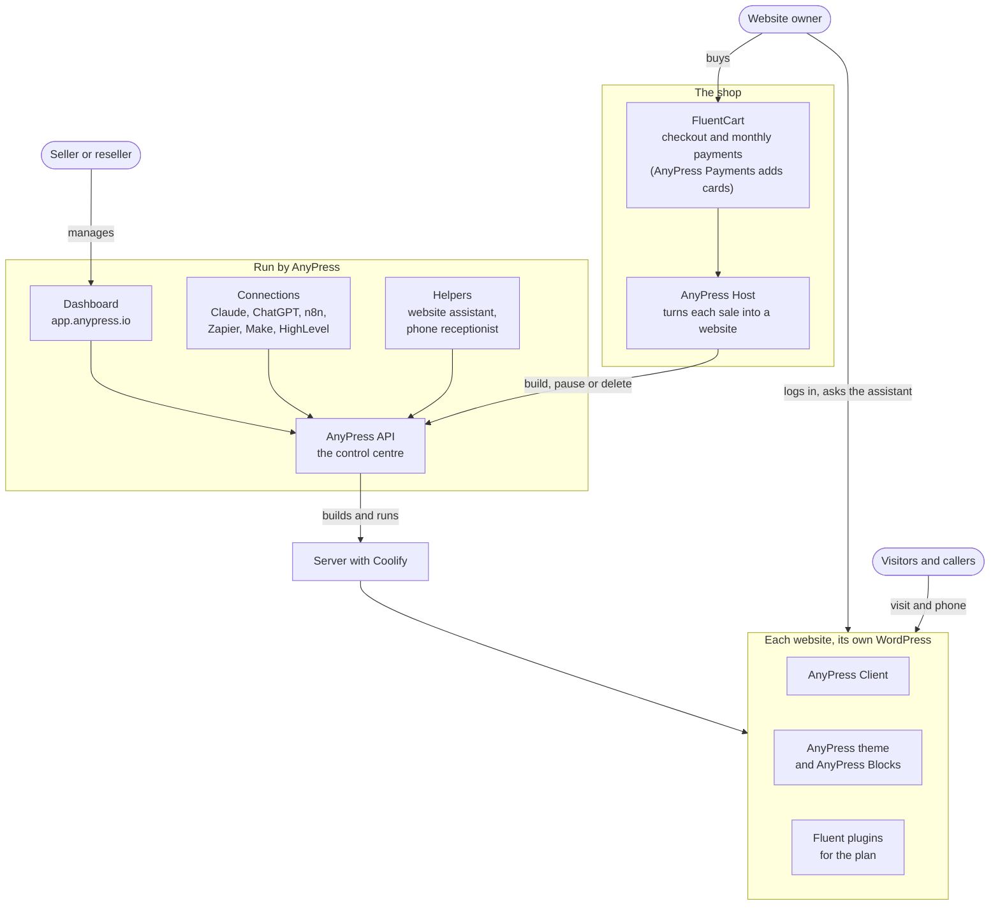
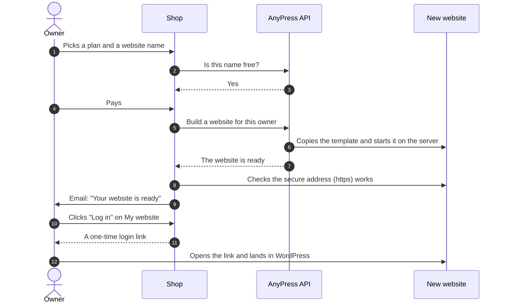
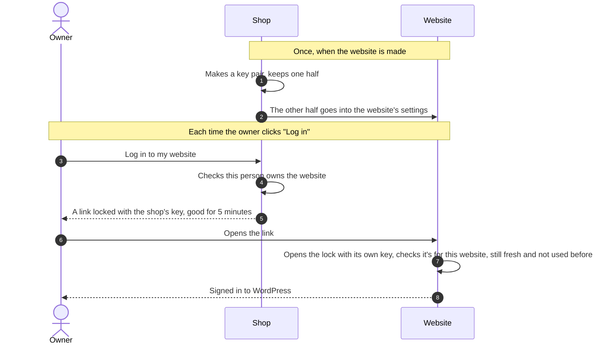
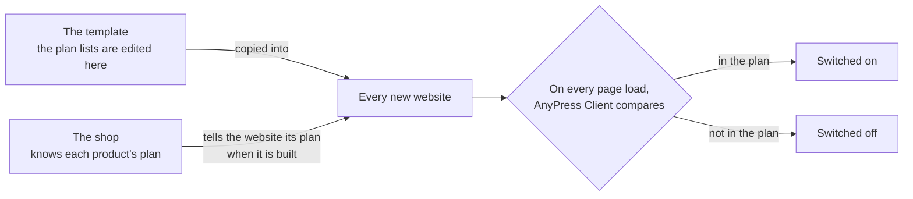
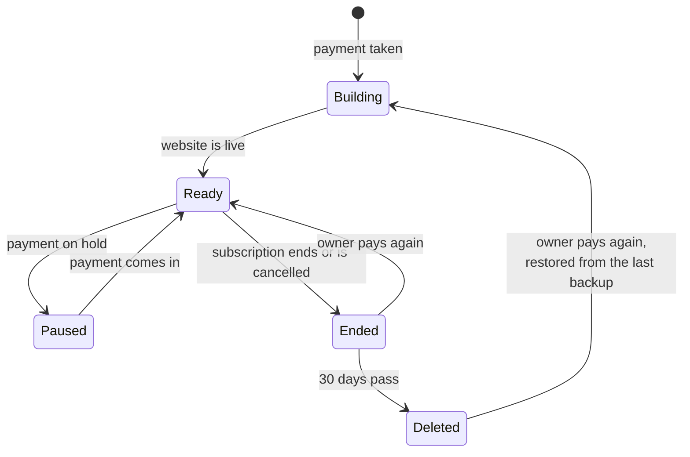
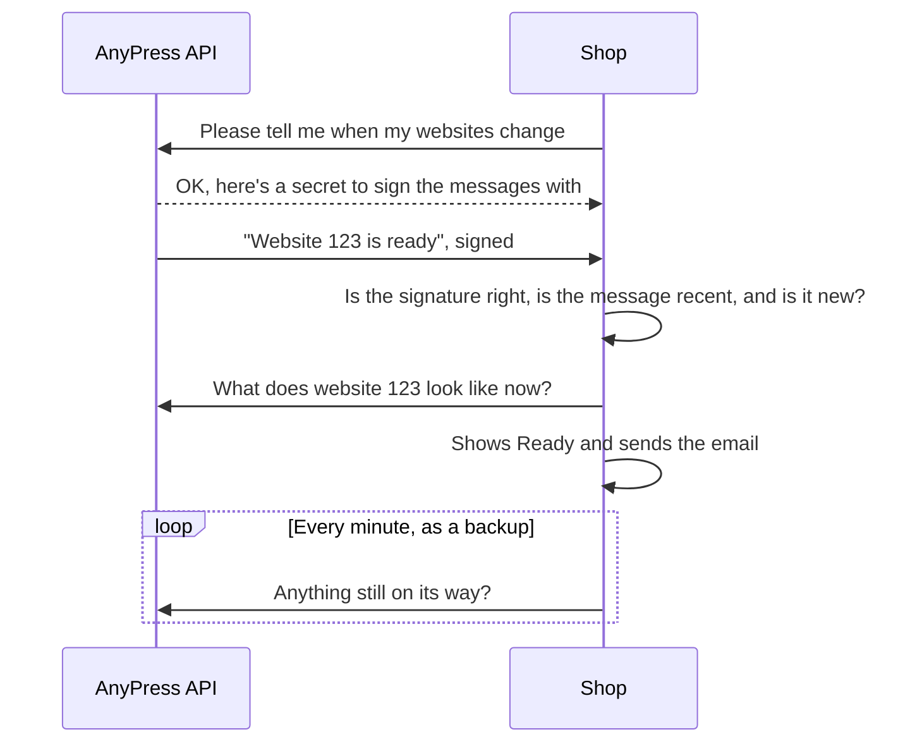
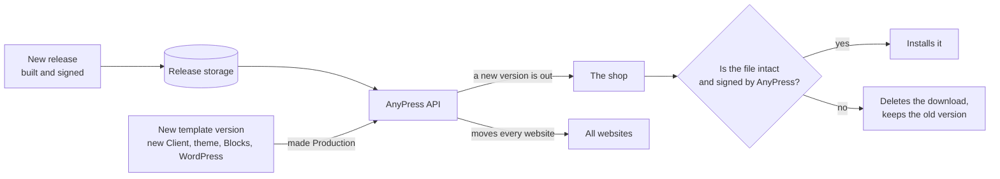
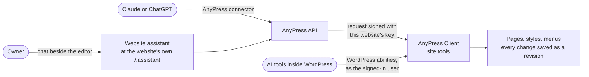
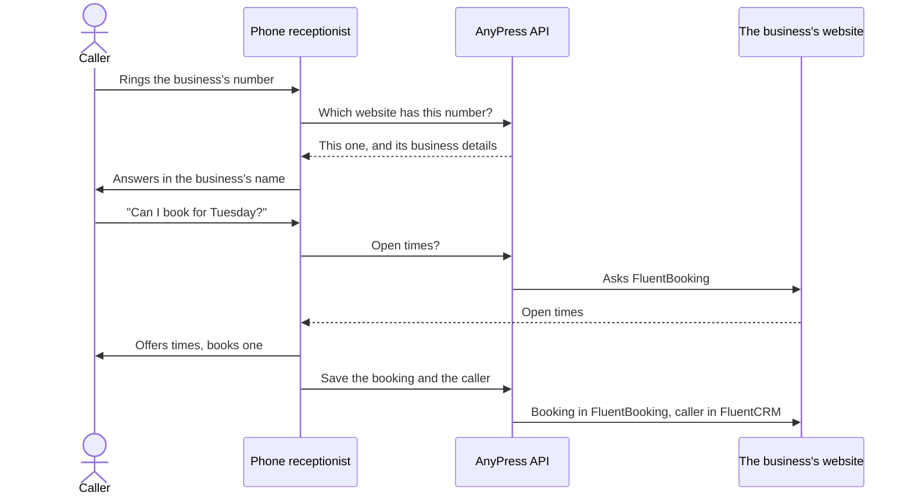
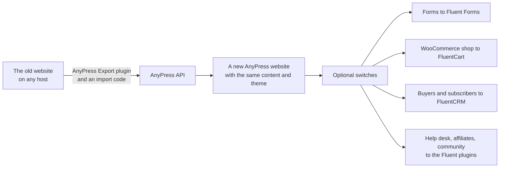

# How AnyPress works, in plain words

This page explains the whole system without the code words. It covers what each part is for, who uses it, and what happens when someone buys a website, logs in, stops paying or asks the assistant for a change. The other pages in this folder have the developer detail: file names, routes and settings.

[Back to the overview](README.md)

## A few words first

| Word | What it means here |
|---|---|
| **Shop** | The WordPress site where websites are sold, such as shop.anypress.io. A seller or reseller can have their own shop. In the code this is called a **storefront**. |
| **Website** | A customer's own WordPress site, made and run by AnyPress. In the code this is called a **store** or a **tenant**. |
| **Owner** | The customer who bought a website and runs it. |
| **AnyPress API** | The control centre. It builds every website, gives it an address, backs it up, pauses it and deletes it. Nothing reaches a website's server except through it. |
| **Server** | The machine the websites run on. Coolify starts and stops each website there, and each one gets its own WordPress and its own database. |
| **Template** | The master copy every new website is made from. It already has the AnyPress theme, AnyPress Blocks, AnyPress Client and the Fluent plugins in it. |
| **Plan** | What the owner paid for, such as Website, Bookings or Store. The plan decides which plugins are switched on. |

## The whole system

Here is what each part does:

- **The shop** sells websites. FluentCart handles the checkout and the monthly payments, with Stripe or, through AnyPress Payments, Authorize.Net. **AnyPress Host** watches those payments and tells the AnyPress API what to do: build a website, pause it, bring it back or delete it.
- **The AnyPress API** is the only thing that builds or changes websites. It works through Coolify on the server, and each website gets its own WordPress and database, so one website can't see another.
- **The dashboard** at app.anypress.io is where sellers, resellers and AnyPress itself see every website, shop, payment and job. It shows each seller's own brand.
- **Connections** let other tools use the AnyPress API: Claude and ChatGPT through the AnyPress connector, the n8n, Zapier and Make apps, the HighLevel app, and webhooks.
- **AnyPress Client** is already on every website, because it's in the template. It handles the one-click login, switches plugins on and off for the plan, and gives the assistant, the phone receptionist and AI apps a safe way to make changes.
- **The AnyPress theme and AnyPress Blocks** give every new website its look. Owners restyle it in the Site Editor, and the assistant uses the same colours, fonts and sections.
- **The website assistant** sits beside the page editor on each website, at the website's own address (`/.assistant`). It changes pages only after the owner says yes.
- **The phone receptionist** answers a business's phone in the business's name, offers open times, books visits in FluentBooking and saves each caller in FluentCRM.

Three rules hold the system together:

1. **Only the shop and the AnyPress API talk to each other.** AnyPress Host asks the API for changes, and the API tells AnyPress Host when something is done. The websites never call the API themselves.
2. **Every change to a website goes through the API.** The dashboard, the assistant, the phone receptionist and the automation apps all ask the API, and the API signs each request with that website's own key.
3. **A website keeps working when the shop or the API is down.** Its visitors, its pages and its owner's login don't depend on either one.

## Buying a website

- Building takes a few minutes. The owner can watch it on **My website**, where it goes through *Queued*, *Setting up*, *Linking the address*, *Getting the secure certificate* and then *Ready*.
- If someone takes the name between checkout and building, the shop asks the owner for a new one and emails them and the admin.
- If a step fails, the shop tries again after 1, 5, 15, 30 and 60 minutes. After the sixth failure it emails the admin, who can press **Retry**.
- The owner's business details from checkout (name, phone, address, what the business does) go into the website, so the assistant and the receptionist know about the business from day one.

## Logging in with one click

The shop and the website never share a password. When the website is made, the shop makes a matching pair of keys for it. The shop keeps one key and gives the other to the website.

- Each link works once and only for a few minutes, so a link in someone's browser history is useless later.
- When anything is wrong, the website gives the same "no" without saying why, so nobody learns how to fake a link.
- The dashboard has its own **Log in to WordPress** button, which works the same way with a link the AnyPress API signs.

## The plan decides which plugins are on

Each plan has a list of plugins. For example, Website turns on Fluent Forms and FluentCRM, and Store adds FluentCart. The list is saved in the template, so every website has a copy.

- If the plan can't be found, AnyPress Client changes nothing and shows the owner a notice, so a mistake can never switch everything off.
- The owner can see their plan, and the plugins it includes, on **Dashboard > Your plan**.
- The shop can stop owners installing or removing plugins themselves, so the plan stays as sold.

## When payments stop, and start again

- **Paused**: visitors see a "this website isn't available" page, but nothing is lost.
- **Ended**: the shop takes a backup first, then pauses the website. It is deleted 30 days later unless the owner pays again.
- **Cancelled with time left**: the website stays up until the paid time runs out.
- **Paying again after deletion** brings the website back from its last backup, or builds a fresh one if no backup is left.
- With AnyPress Payments (Authorize.Net), a renewal is never charged twice. If the bank doesn't answer, it looks the charge up the next day instead of charging again. FluentCart retries a declined card over the 7-day grace period and emails the owner a **Pay now** link.

## How the shop hears back from the API

When a website is ready, restored, deleted or gets a new address, the API tells the shop straight away with a signed message, called a webhook. The shop also checks in every minute, in case a message goes missing.

- A message with a wrong signature, or one older than 5 minutes, is refused. A message that arrives twice is acted on once.
- The message only says *which* website changed. The shop always asks the API for the latest, so it never acts on old news.

## Updates

AnyPress Host and AnyPress Payments update themselves on the shop. Each update is signed when it is released, and the shop checks the signature before installing it. AnyPress Client, the theme and AnyPress Blocks don't update on each website. A new template version carries them, and the API moves every website onto it.

- A download that fails either check is thrown away before WordPress touches the installed plugin.
- When a new template version becomes Production, the API moves every website onto it. If a website fails to move, the API puts it back on the old version.

## Changing a website with AI

There are three ways in, and they all use the same safe tools on the website. They can change pages, sections, colours, fonts, the header, the footer, menus and images, and nothing else: no plugins, no settings, no orders.

- Before an app can work on a website, the owner signs in with **Sign in with your website** and presses **Allow** on their own website.
- The assistant reads the business profile first, so it knows what the business is. It waits for the owner's yes before any change visitors would see. New pages always start as drafts.
- WordPress keeps a revision of every change, so any change can be undone.
- Each plan comes with a monthly number of assistant messages: 150, 300 or 600 for Small, Medium and Large.

## The phone receptionist

- Urgent callers can be put through to the owner's mobile, or the receptionist takes a message.
- Every call is logged and counted against the website's monthly minutes. When the minutes run out, it still answers and takes messages but doesn't book.

## Moving an existing website in

- The owner gets an import code on AnyPress, installs **AnyPress Export** on the old website and sends it. A big upload goes in parts, so it can carry on after a break.
- The moved website keeps its own theme and content. The Fluent plugins are installed but switched off.
- Each switch has a dry run that changes nothing and reports what it would do, and an undo. The old plugins and their data are never changed or deleted.
- The CRM switch never sends emails while it runs, and only marks people as subscribed where they agreed to it.

## Sellers and resellers

- A **seller** sells websites under their own name from their own shop. A **reseller** runs several shops and gets one monthly bill.
- On a reseller's websites, AnyPress Client and the dashboard show the reseller's brand, for example "KnowBS Client".
- The dashboard's **Sell** page has a sales kit. It includes a prospect finder, outreach emails sent from the seller's own mailbox, and draft FluentCRM and HighLevel automations.
