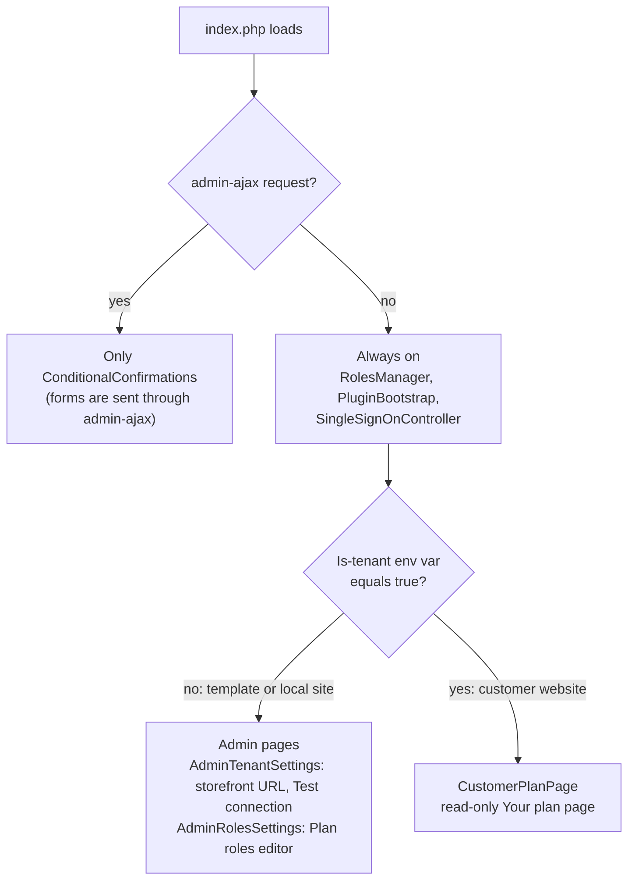
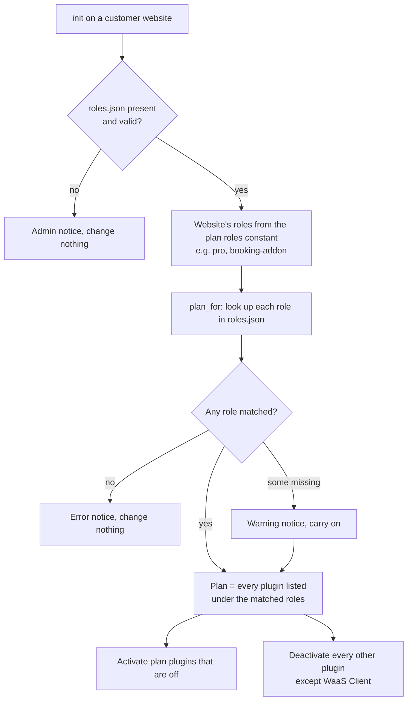
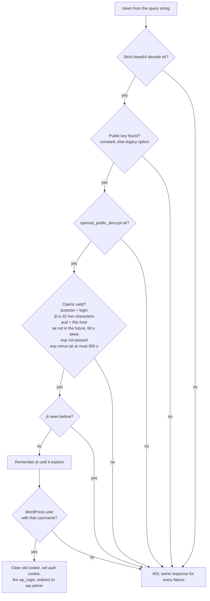
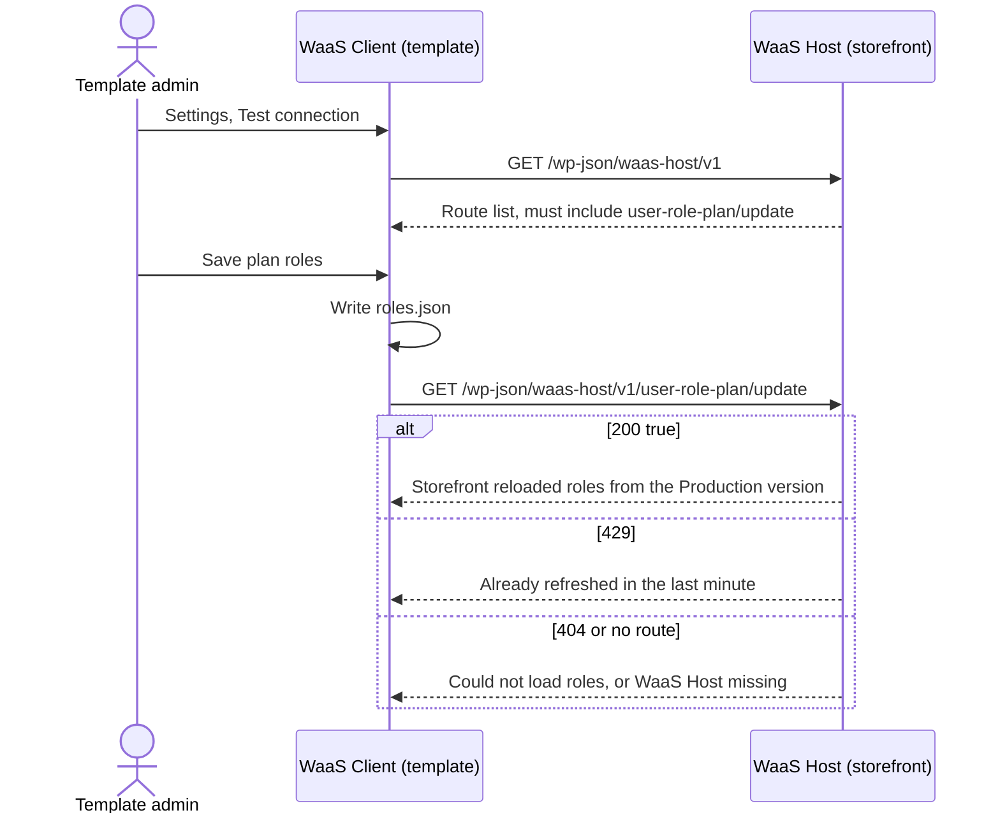

# WaaS Client

WaaS Client lives inside the template that customer websites are copied from, so it is in every website. It does three things: checks one-click login tokens from the storefront, turns plugins on or off by plan role, and (on the template only) lets you edit the plan roles. It never calls the provisioning API. Paths are relative to `packages/waas-client/`.

[Back to the overview](README.md)

## Two modes: template and customer website

The same plugin behaves differently depending on one environment variable, the "is tenant" flag, which the provisioning API sets to `true` on every customer website and nowhere else.



Sources: `index.php`, `src/Features/PluginBootstrap.php`, `src/Features/AdminTenantSettings.php`, `src/Features/AdminRolesSettings.php`, `src/Features/CustomerPlanPage.php`.

### What a customer website is given

WaaS Client reads everything it needs from the website itself. WaaS Host puts the constants in its `POST /v1/tenants` request, and the API writes them into `wp-config.php`.

| Setting | Kind | Comes from | Read by |
|---|---|---|---|
| Is-tenant flag (`true`) | Environment variable | The API's website container | `index.php`, `RolesManager.php`, `PluginBootstrap.php` |
| Plan roles (comma list) | PHP constant | WaaS Host, from the products bought | `RolesManager.php` |
| Login public key (base64 PEM) | PHP constant | WaaS Host, one key pair per website | `SingleSignOnController.php` |
| Remove plugin rights from administrators (`true`/`false`) | PHP constant | WaaS Host setting | `PluginBootstrap.php` |
| `waas_host_website_url` | WordPress option | Set on the template, copied into each website | `CustomerPlanPage.php` |
| `waas-client-data/roles.json` | File | Shipped inside the template | `RolesManager.php`, `CustomerPlanPage.php` |

## Plugins by plan role

On a customer website, on every `init`, `RolesManager` makes the active plugins match the website's plan.



Source: `src/Features/RolesManager.php` (`activate_enabled_plugins`, `plan_for`).

- `roles.json` looks like `{"pro": {"title": "Pro", "plugins": ["fluent-crm/fluent-crm.php", ...]}}` (`src/Features/AdminRolesSettings.php`).
- When the remove-plugin-rights constant is `true`, the website's administrators lose the six plugin capabilities (activate, delete, install, update, edit, upload). The Plugins screen shows "Activated by the WaaS Client" in place of the toggle links (`src/Features/PluginBootstrap.php`).
- The **Your plan** page lists each role and its plugins, and links back to the storefront. It makes no network calls.

How roles get from the template to the storefront is drawn in the overview: [Plan roles](README.md#plan-roles-which-plugins-a-website-gets).

## Checking a login token

`GET /wp-json/waas-client/v1/single_login/verify?token=...` is public, because the signed token is the credential. Every check must pass, and every failure gets the same 403 `waas_single_login_failed`.



Sources: `src/Api/SingleSignOnController.php` (`verify_single_login`, `claims_are_valid`), `src/Core/DecryptionService.php`.

- The username is the one WaaS Host created the website with, built from the customer's name (`waas-host/src/Features/SingleLoginService.php`).
- The `waas_sso_admin_url` filter can send the user somewhere other than wp-admin.

## Talking to the storefront

WaaS Client only calls the storefront, and only from the template's admin pages.



Sources: `src/Features/StorefrontStatus.php`, `src/Core/HttpService.php`, `waas-host/src/Api/RolesController.php`.

## Moving forms to Fluent Forms

A website moved into AnyPress often has its forms in Contact Form 7, WPForms (Lite) or Ninja Forms. The forms switch moves them to Fluent Forms and switches the pages over. Run it with WP-CLI as an administrator, with Fluent Forms and the old form plugins active:

```sh
wp waas forms switch --user=admin --dry-run   # what would be converted, dropped and switched; changes nothing
wp waas forms switch --user=admin             # do it
wp waas forms switch --user=admin --undo      # put the old shortcodes and blocks back
```

Add `--format=json` for the report as JSON. The same is available as two abilities: `anypress/check-forms` (the dry run, read-only) and `anypress/switch-forms` (with `{"undo": true}` to undo). Both need an administrator.

What it does, in order:

1. **Converts each form** with Fluent Forms' own importer (Fluent Forms → Tools → Migrator), and fixes what that importer gets wrong:
   - Contact Form 7: the emails are built from the form's Mail and Mail (2) (recipient, sender, subject, body, Reply-To, Cc, Bcc, with the mail tags turned into Fluent Forms smart codes), the thank-you message from its "sent" message, and the malformed notification rows the importer writes are deleted. Placeholders stay placeholders and a date field stays a date.
   - WPForms: the confirmation that applies to every submission is the main one, and a conditional one (such as a redirect for one answer) stays conditional. Free Fluent Forms stores conditional confirmations but only Fluent Forms Pro runs them, so WaaS Client runs them for the converted forms while Pro is off (`src/Forms/ConditionalConfirmations.php`).
   - Ninja Forms: each email keeps its own Reply-To, and the date format is converted (`MM/DD/YYYY` becomes `m/d/Y`).
   - Entries (Contact Form 7 through Flamingo, Ninja Forms, WPForms Pro) keep the date each was sent and their order; Contact Form 7 entries also keep the visitor's IP address and page. All Flamingo messages are read, not only the first 10.
2. **Reports** every dropped field of each form by name and type, with the reason (most need Fluent Forms Pro), and anything else that didn't come across: show/hide rules on fields, email attachments, mail tags with no Fluent Forms equivalent, entries past Fluent Forms' limit of 1,000 per form.
3. **Switches the pages over**: the old shortcodes (`[contact-form-7]`, `[contact-form]`, `[wpforms]`, `[ninja_form]`, `[ninja_forms]`) and blocks become `[fluentform id="…"]` and the Fluent Forms block, in posts, pages, templates, template parts, synced patterns and Text, Custom HTML and block widgets. Each changed post keeps a revision. Forms inside a page builder's own layout (Elementor, Beaver Builder) are listed in the report, not changed.

Running it again changes nothing that was already done: converted forms are skipped, entries are only brought into a Fluent Forms form that has none, and pages already switched have nothing left to swap. The old plugins and their forms are never changed, deactivated or deleted, so they keep working until the owner turns them off. Undo puts back the exact old content of each page or widget that wasn't edited since, and swaps the forms back in one that was; the Fluent Forms forms and their entries stay.

The id map and each changed page's original content are kept in the `waas_client_forms_switch` option (not autoloaded). Sources: `src/Forms/FormsSwitch.php`, `src/Forms/Migrators/`, `src/Forms/PageSwitcher.php`, `src/Forms/FormsCommand.php`, `src/Forms/FormsAbilities.php`. Tested end to end by `scripts/playground/forms.mjs` (`npm run forms`).

## Updates

WaaS Client does not update itself. Its `Update URI` header only keeps wordpress.org from offering updates. A website gets a newer WaaS Client when it is moved to a newer template version, whose code replaces the website's plugins (`index.php`, `tests/Unit/NoSelfUpdateTest.php`).
