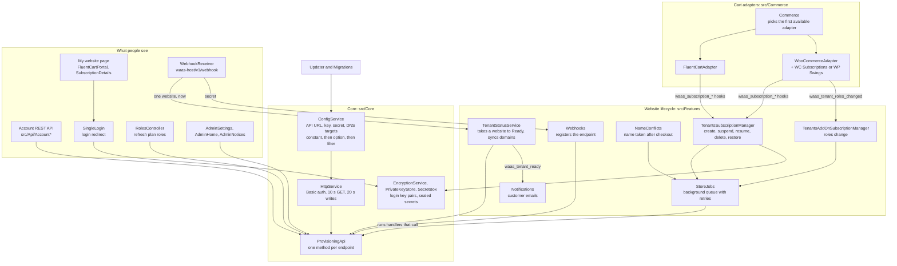
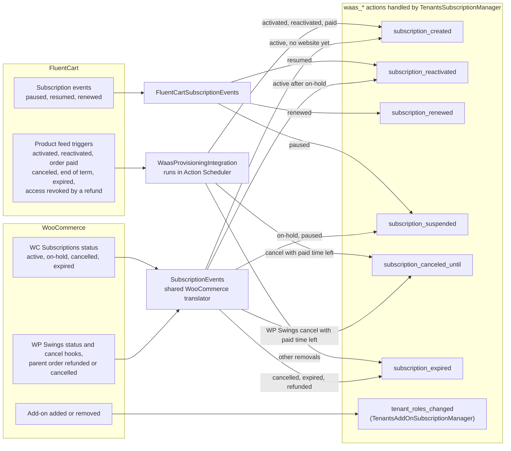
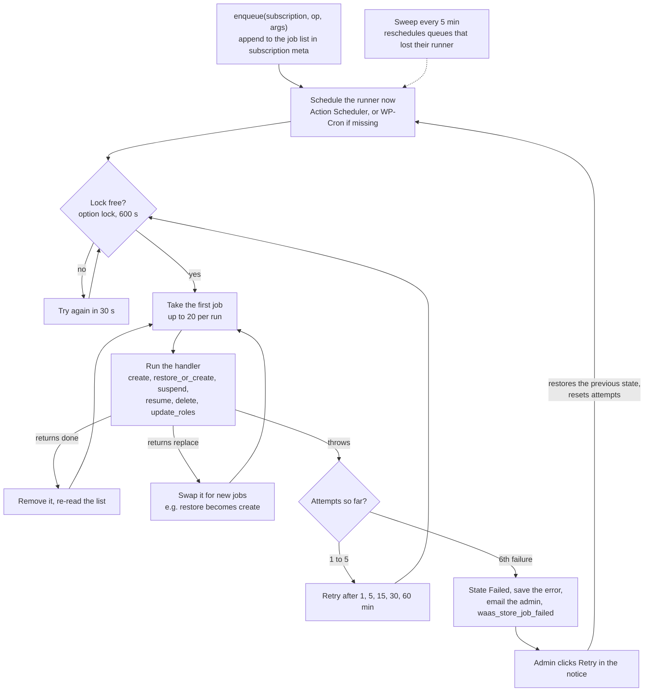
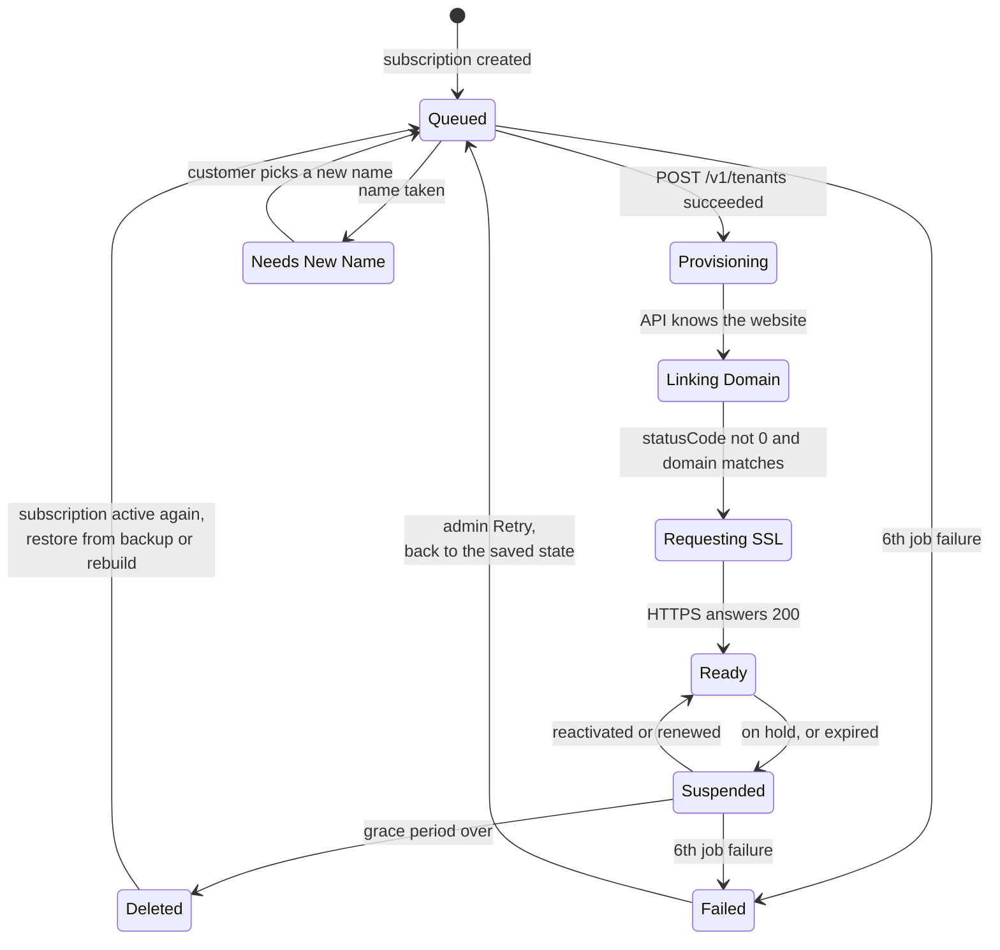
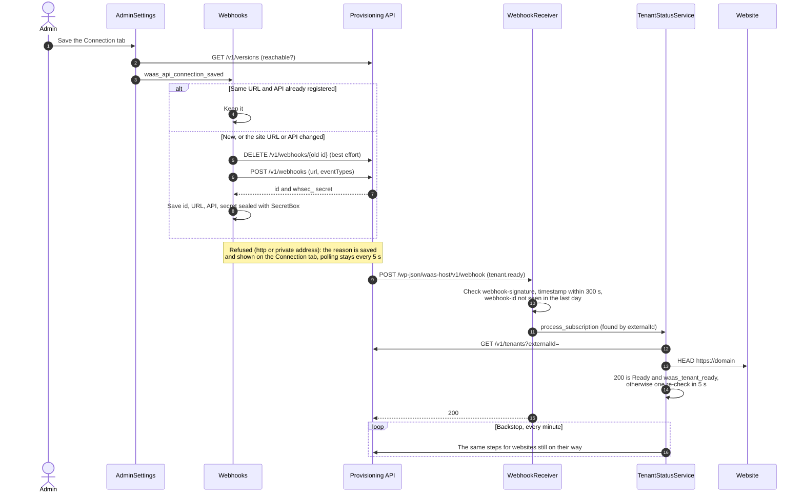
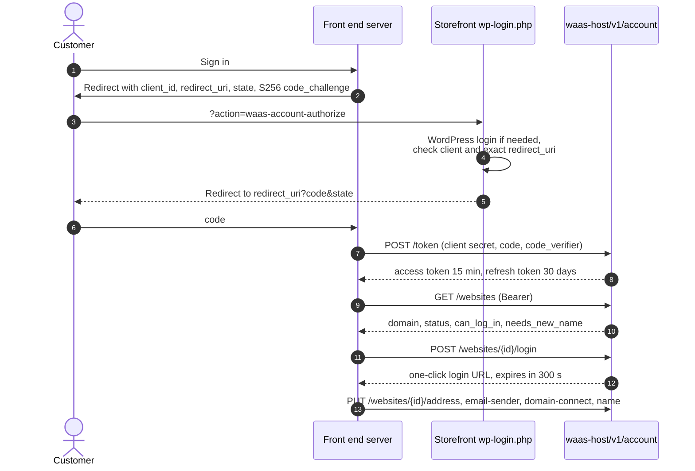

# WaaS Host

WaaS Host runs on the storefront. It listens to the cart's subscription events, turns them into provisioning API calls run in the background, tracks each website's state, and gives customers their website page and one-click login. Paths are relative to `packages/waas-host/`.

[Back to the overview](README.md)

## Inside the plugin

Everything is wired in `index.php` when the plugin loads. One `ProvisioningApi` instance is shared by every part that talks to the API.

- If both carts are active, FluentCart wins because it is registered first. The `waas_commerce_adapter` filter can pick the other (`src/Commerce/Commerce.php`).
- Only the chosen adapter's `boot()` runs, so the other cart's hooks are never added.
- All website state is kept in **subscription meta** through the adapter. There are no custom tables ([Where data lives](#where-data-lives)).

## From cart events to website actions

Each cart reports subscription changes differently. The adapters translate them into a small set of `waas_subscription_*` actions, and `TenantsSubscriptionManager` handles only those.

Sources: `src/Commerce/FluentCart/WaasProvisioningIntegration.php`, `src/Commerce/FluentCart/FluentCartSubscriptionEvents.php`, `src/Commerce/WooCommerce/WooCommerceSubscriptions.php`, `src/Commerce/WooCommerce/WpSwingsSubscriptions.php`, `src/Commerce/WooCommerce/SubscriptionEvents.php`.

- On FluentCart a cancellation with paid time left becomes `canceled_until`, so the website stays up until the paid period ends. Otherwise it becomes `expired`.
- If a FluentCart remove trigger arrives but the subscription is active again, the website is kept.
- `waas_subscription_renewed` is only fired on FluentCart. It resumes a website that was suspended for a missed payment.

### What each action does

| Action | Handler in `TenantsSubscriptionManager.php` | Job, then API call |
|---|---|---|
| `waas_subscription_created`, no website yet | `create_tenant_when_subscription_created` | `create`: `POST /v1/tenants` |
| `waas_subscription_created`, website suspended | same | `resume`: `POST /v1/tenants/resume` |
| `waas_subscription_created`, website deleted | same | `restore_or_create`: `GET /v1/tenants/backups`, then `POST /v1/tenants/restore`, or a new website if no backup is left |
| `waas_subscription_suspended` (payment on hold) | `suspend_tenant_on_hold` | `suspend`: `POST /v1/tenants/suspend` without a backup. Nothing is scheduled for deletion. |
| `waas_subscription_reactivated` | `resume_suspended_tenant` | `resume`: `POST /v1/tenants/resume` |
| `waas_subscription_renewed` | `resume_after_renewal` | `resume`, only if the website was suspended for on-hold or ended |
| `waas_subscription_expired` | `suspend_tenant_when_subscription_expired` | `suspend` with a backup, and deletion scheduled after the grace period (default 30 days) |
| `waas_subscription_canceled_until` | `suspend_at_end_of_paid_period` | Nothing yet. At the end of the paid period it runs the expired path, unless the subscription is active again. |
| Grace period over | `delete_suspended_tenant` | `delete`: `DELETE /v1/tenants` |
| `waas_tenant_roles_changed` | `TenantsAddOnSubscriptionManager::update_tenant_roles` | `update_roles`: `PUT /v1/tenants` with the new roles constant |

## Purchase to a ready website

```mermaid
sequenceDiagram
  autonumber
  actor C as Customer
  participant CK as Checkout field
  participant CART as Cart
  participant TSM as TenantsSubscriptionManager
  participant JOBS as StoreJobs
  participant API as Provisioning API
  participant TSS as TenantStatusService

  C->>CK: Enter a website name
  CK->>API: GET /v1/tenants/domains/available
  Note right of CK: Also checks no local subscription<br/>already holds that name. If the API<br/>is down the name is saved as unverified.
  CK->>CART: Save the name in order meta
  C->>CART: Pay
  CART->>TSM: waas_subscription_created(subscription, order)
  TSM->>TSM: Build the request from the plan products<br/>roles, group, size, owner country
  TSM->>TSM: externalId = new UUID, state Queued,<br/>reserve the domain in subscription meta
  TSM->>JOBS: enqueue(create)
  JOBS->>JOBS: Schedule the runner in Action Scheduler
  JOBS->>TSM: job_create (in a background request)
  TSM->>TSM: Make the login key pair (once)
  TSM->>API: POST /v1/tenants
  alt Name was taken meanwhile
    API-->>TSM: 400 already in use
    TSM->>TSM: NameConflicts park, state Needs New Name,<br/>email customer and admin
  else Created
    API-->>TSM: id, externalId, baseDomain, customDomain
    TSM->>TSM: Save externalId and domains, fire waas_tenant_linked_to_subscription
    TSM->>TSS: state Provisioning
    API->>TSS: Webhook tenant.ready, through WebhookReceiver
    TSS->>API: GET /v1/tenants?externalId=
    Note right of TSS: Provisioning, then Linking Domain<br/>once statusCode is not 0 and the<br/>domain matches
    TSS->>TSS: Requesting SSL: HEAD https://domain
    opt Not 200 yet
      TSS->>TSS: One re-check 5 seconds later, then the poll
    end
    loop Status poll cron, every minute (every 5 seconds without webhooks)
      TSS->>API: The same steps for websites still on their way
    end
    TSS->>C: State Ready, waas_tenant_ready, "website ready" email
  end
```

Sources: `src/Commerce/FluentCart/FluentCartCheckout.php`, `src/Features/UserWcTenantsCheckout.php`, `src/Features/TenantsSubscriptionManager.php` (`create_tenant_when_subscription_created`, `new_store_args`, `job_create`, `key_pair`), `src/Features/NameConflicts.php`, `src/Api/WebhookReceiver.php`, `src/Features/TenantStatusService.php` (`process_subscription`, `poll_tenant_status`), `src/Features/Notifications.php`.

- If a retry runs after an earlier attempt already created the website, `job_create` asks the API for it by `externalId` and adopts it, so a website is never made twice.
- The `POST /v1/tenants` body carries: name, WordPress username (from the customer's name) and email, the default user role, group and size, the roles, the public login key, whether to remove plugin rights from administrators, and the options `blogname`, `admin_email` and `waas_store_owner` (JSON: the billing country, name, phone and address, which the store fills in as its business details, time zone and currency).
- Every 1 minute a second cron copies each website's current domain from `GET /v1/tenants`, so the API stays the source of truth for domains. A `tenant.domains_changed` webhook does the same for one website at once.

## The background job queue

API calls never run inside the cart's own hooks. Each subscription has a queue of jobs in its meta, and a runner works through it in the background.

Source: `src/Features/StoreJobs.php` (`enqueue`, `run`, `RETRY_DELAYS`, `retry`, sweep).

## Website states

The state is kept in subscription meta and shown to the customer. The API has its own simpler status code (0 pending, 1 done, 2 failed, 3 removing) which WaaS Host reads when a webhook arrives and while polling.

Source: `src/Core/Tenant.php` (state names), `src/Features/TenantStatusService.php` (the three in-progress states), `src/Features/TenantsSubscriptionManager.php`, `src/Features/StoreJobs.php`.

- Failed can follow any job, not only the two drawn. Retry returns to whatever state was saved with the failure.
- A suspension has a reason. `on_hold` keeps the website with no backup and no deletion date. `ended` takes a backup and schedules deletion. Only these two are resumed by a renewal (`src/Core/Tenant.php`).

## Webhooks

The API tells WaaS Host when a website changes, so the customer doesn't wait on a poll. WaaS Host registers one endpoint for the storefront and acts on four events. The payload only names the website: its state is read from the API again by the poller's own code, so the HTTPS check, the Ready state and `waas_tenant_ready` behave as they do when polling.

Sources: `src/Features/AdminSettings.php` (`render_waas_admin_page`), `src/Features/Webhooks.php` (`ensure_registered`), `src/Api/WebhookReceiver.php` (`verify`, `handle`, `dispatch`), `src/Features/TenantStatusService.php` (`process_subscription`, `recheck_soon`, `poll_recurrence`), `src/Core/SecretBox.php`.

| Event | What WaaS Host does |
|---|---|
| `tenant.ready`, `tenant.restored` | Runs the poller's steps for that website now. If HTTPS doesn't answer 200 yet, one re-check 5 seconds later, then the poll |
| `tenant.domains_changed` | A live website takes the API's current domain, read again with `GET /v1/tenants?externalId=`. One still being set up gets the poller's next step |
| `tenant.failed` | Saved on the subscription (`_waas_tenant_api_failure`), logged, `waas_tenant_failed` fired, and shown in an admin notice until dismissed or the website is Ready. The state is left to the poll |
| Anything else | Answered 200 and ignored. Suspend, resume and delete start on the storefront, which already knows |

- **Registering** happens when the Connection tab is saved and the API answers, from the tab's **Register** button, and in an hourly WP-Cron check that needs no admin (API settings in `wp-config.php`, a site that moved). Endpoints at the same URL that WaaS Host has no secret for are deleted first, so a lost answer doesn't leave extras behind.
- **Answers:** 401 for a missing, stale or wrong signature, 400 for a body that isn't an event, 200 for everything else, a repeat included. The event id is remembered only once the event was handled, so a delivery that failed here is retried by the API.
- **Polling:** the status cron runs every minute while an endpoint is registered and every five seconds while not. The cron run moves itself to the other schedule when that changes.

## Every API call WaaS Host makes

All calls go through `src/Core/ProvisioningApi.php` with `Authorization: Basic base64(key:secret)` from `src/Core/HttpService.php`. Websites are addressed by `externalId`, the UUID WaaS Host chose.

| Endpoint | Method in `ProvisioningApi.php` | Used by |
|---|---|---|
| `GET /v1/versions` | `test_reachability`, `get_production_version` | Settings connection test, roles refresh |
| `GET /v1/snapshots?onlyProductionVersion=true` | `get_available_groupnames` | Product setup (snapshot groups), cached 10 minutes |
| `POST /v1/tenants` | `create_tenant` | `create` job |
| `GET /v1/tenants`, `GET /v1/tenants?externalId=` | `get_tenants`, `get_tenant_safe` | Status poll, domain sync, retries |
| `PUT /v1/tenants` | `update_tenant` | `update_roles` job |
| `DELETE /v1/tenants` | `delete_tenant` | `delete` job |
| `POST /v1/tenants/suspend`, `/resume` | `suspend_tenant`, `resume_tenant` | `suspend`, `resume` jobs |
| `GET` and `POST /v1/tenants/backups`, `POST /v1/tenants/restore` | `get_tenant_backups`, `create_tenant_backup`, `restore_tenant` | Expiry, `restore_or_create` job |
| `POST` and `DELETE /v1/tenants/domains` | `add_tenant_domain`, `delete_tenant_domain` | Customer changes the website address |
| `GET /v1/tenants/domains/available` | `domain_available` | Checkout and new-name checks |
| `GET`, `PUT`, `DELETE /v1/tenants/mail-domain` | `get_mail_domain`, `set_mail_domain`, `remove_mail_domain` | Customer's own email sending domain |
| `GET /v1/tenants/domain-connect` | `domain_connect` | "Connect automatically" DNS button |
| `GET`, `POST /v1/webhooks`, `DELETE /v1/webhooks/{id}` | `get_webhook_endpoints`, `create_webhook_endpoint`, `delete_webhook_endpoint` | Registering the webhook endpoint |
| `GET /v1/plugins/{slug}/update` | `src/Updater/Updater.php` | Update checks |

Two calls go elsewhere: `RolesController` downloads `roles.json` from the Production version's site, and the status check sends `HEAD https://<domain>` to the website itself. The API calls WaaS Host back only at `POST /wp-json/waas-host/v1/webhook` ([Webhooks](#webhooks)).

## Customer account API

Customers can see and manage their websites from a front end on another domain. WaaS Host is the sign-in server: it issues short access tokens with OAuth 2 authorization code and PKCE. The contract is in [account-api.md](../account-api.md).

Sources: `src/Api/AccountSignIn.php`, `src/Api/AccountTokens.php`, `src/Api/AccountClients.php`, `src/Api/AccountController.php`, `src/Features/WebsiteSettings.php`.

- Front ends are registered with `wp waas-host account-client add` (`src/Api/AccountClientsCommand.php`).
- Tokens are stored only as HMACs in user meta. Each refresh rotates both tokens, and reusing an old refresh token ends that session. Changing the password ends every session.
- Website routes need the signed-in user to own the subscription. Login links are limited to 10 a minute per user.

## Where data lives

| Data | Stored in |
|---|---|
| The link to the API's website (`externalId`), domains, roles, state, suspend and delete dates, name conflict, job queue, job failure | Subscription meta (WooCommerce order meta, or FluentCart subscription meta), keys in `src/Core/Tenant.php` and `src/Features/StoreJobs.php` |
| Login private key | Subscription meta `_waas_tenant_private_key`, sealed by `src/Core/PrivateKeyStore.php` |
| Website name chosen at checkout | Order meta |
| Plan role, snapshot group, size per product | FluentCart product feed `waas_provisioning`, or WooCommerce product meta (`src/Core/StoreProduct.php`) |
| Plan roles list | Option `waas-host-roles-options` |
| API login, website domain, DNS targets, grace days, emails | Options or `wp-config.php` constants (`src/Core/ConfigService.php`, `src/Features/AdminSettings.php`) |
| Account sessions | User meta `waas_account_sessions` |
| Account front ends | Option `waas_host_account_clients` |
| Webhook endpoint: id, URL, API, signing secret sealed by `src/Core/SecretBox.php`, last error, last event | Option `waas_host_webhook` |
| Webhook event ids already handled | Transients, one day |
