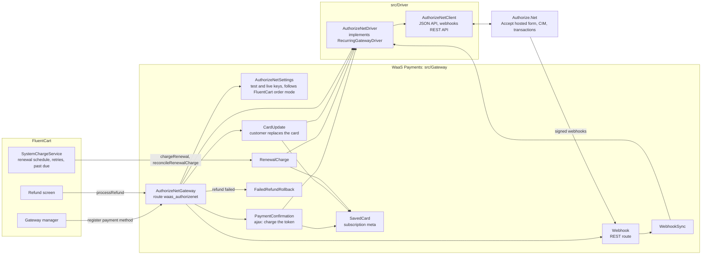
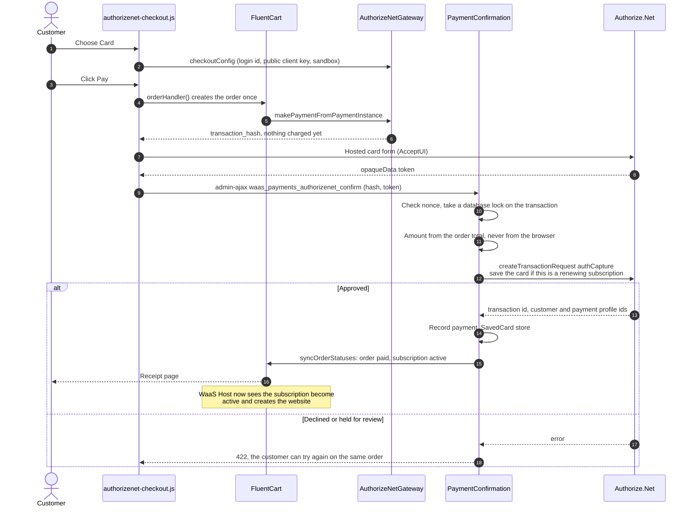
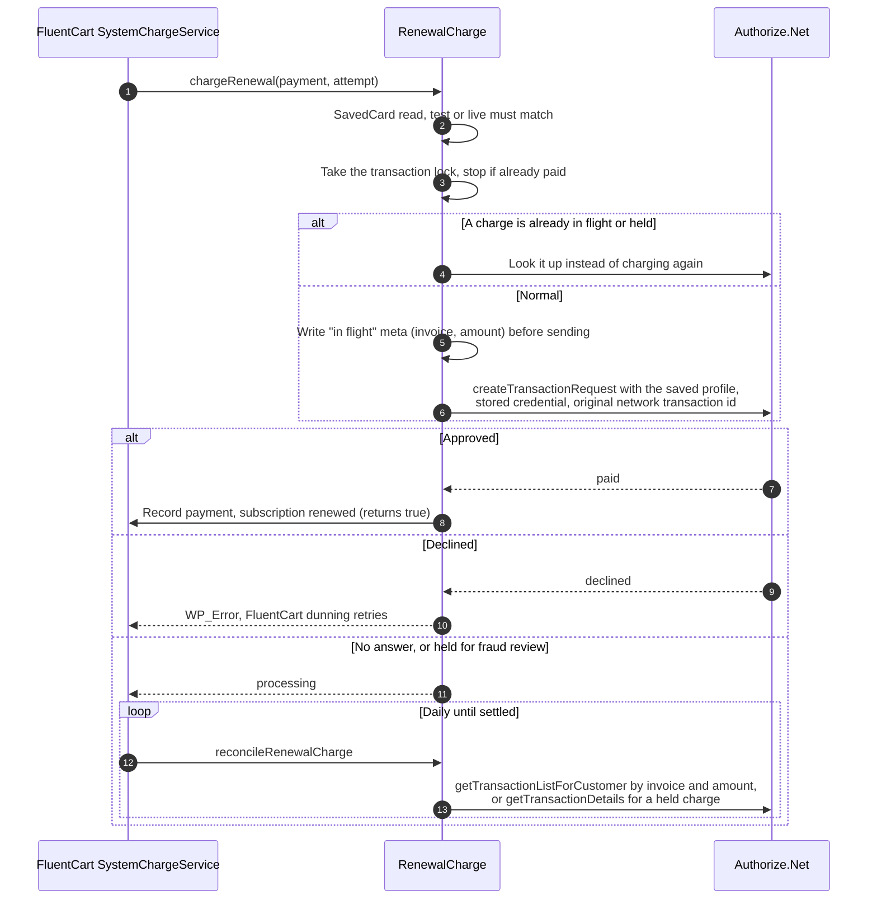
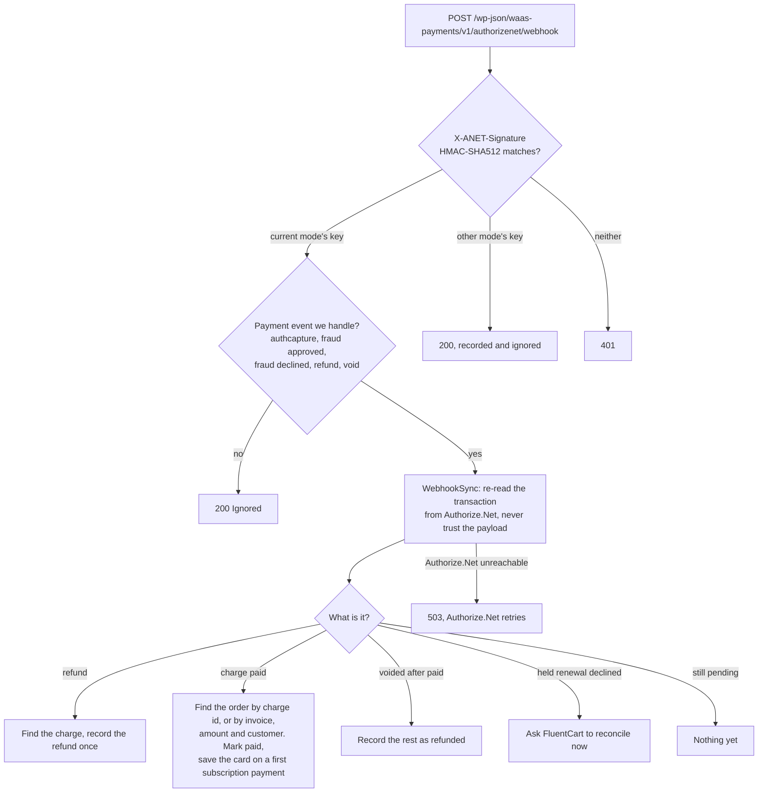
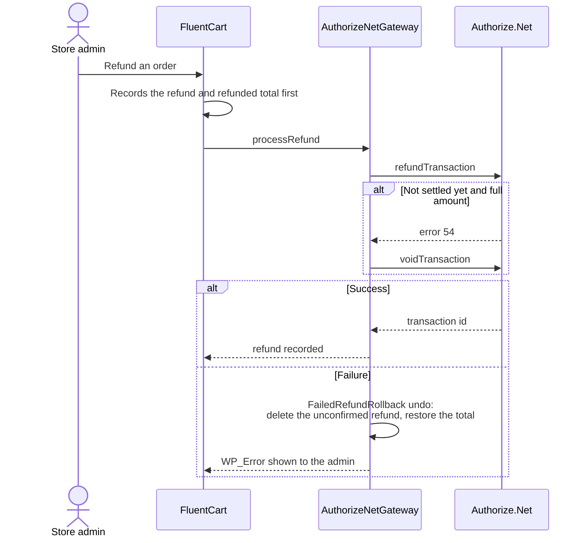

# WaaS Payments

WaaS Payments adds Authorize.Net card payments to FluentCart on the storefront, including subscriptions that the storefront charges on each renewal. Storefronts that can use FluentCart's own Stripe gateway do not need it. It does not talk to the provisioning API or to WaaS Host directly: it marks FluentCart orders and subscriptions paid, and WaaS Host reacts to those subscription events as usual. Paths are relative to `packages/waas-payments/`.

[Back to the overview](README.md)

## Inside the plugin

Sources: `waas-payments.php`, `src/Gateway/*.php`, `src/Driver/*.php`, `src/Driver/AuthorizeNet/*.php`.

- Card numbers never reach the storefront. The browser sends the card to Authorize.Net's hosted form and gets back a one-time token. The driver only ever sees tokens and saved-profile ids (`src/Driver/GatewayDriver.php`).
- Saved cards are Authorize.Net customer profiles (CIM). FluentCart, not Authorize.Net, runs the renewal schedule, so there is no Authorize.Net recurring billing (ARB) and no cron in this plugin (`src/Driver/AuthorizeNet/AuthorizeNetDriver.php`).
- The gateway declares no gateway-billed subscription module, so FluentCart only offers it for subscriptions the storefront charges itself (`src/Gateway/AuthorizeNetGateway.php`).

## First purchase

Sources: `assets/authorizenet-checkout.js`, `src/Gateway/AuthorizeNetGateway.php`, `src/Gateway/PaymentConfirmation.php`, `src/Gateway/SavedCard.php`.

- A free trial (total of 0) saves the card without charging.
- If the card could not be saved and no older card exists, the subscription is switched to manual payment so the customer is asked to pay at renewal instead of failing silently.

## Renewals

FluentCart decides when to charge. WaaS Payments makes sure a renewal is never charged twice, even if Authorize.Net does not answer.

Source: `src/Gateway/RenewalCharge.php` (`charge`, `reconcile`, `settle`, `outcome`).

- After a decline, FluentCart's dunning retries at 25%, 60% and 90% of the grace period and emails the customer a Pay Now link. The subscription becomes past due on the due date and expired when the grace period ends. Expiry is a WaaS Host remove trigger, so the website is suspended with a backup and scheduled for deletion. A later payment reactivates the subscription, which resumes the website ([WaaS Host](waas-host.md#from-cart-events-to-website-actions), [waas-payments README](../../packages/waas-payments/README.md)).
- When a customer replaces a failing card on the card update page (`/?waas_payments_card_update=<subscription>`), any unpaid renewal is charged right away (`src/Gateway/CardUpdate.php`).

## Webhooks

Saving the settings with a Signature Key registers a webhook with Authorize.Net. It catches what happens outside the storefront: refunds made in the Authorize.Net dashboard and fraud reviews that finish later.

Sources: `src/Gateway/Webhook.php`, `src/Gateway/WebhookSync.php`, `src/Driver/AuthorizeNet/AuthorizeNetDriver.php` (`registerWebhook`).

- The webhook needs pretty permalinks, because Authorize.Net rejects URLs with a query string.

## Refunds

Sources: `src/Gateway/AuthorizeNetGateway.php` (`processRefund`), `src/Gateway/FailedRefundRollback.php`, `src/Driver/AuthorizeNet/AuthorizeNetDriver.php` (`refund`).

- A partial refund of a charge that has not settled is refused, because Authorize.Net can only void the whole amount at that point.

## Test and live

Each mode has its own API login, transaction key, signature key and public client key. Which set is used follows FluentCart's store **Order Mode** (`src/Gateway/AuthorizeNetSettings.php`). Every charge and saved card remembers its mode, so a test card is never charged with live keys after the switch.
